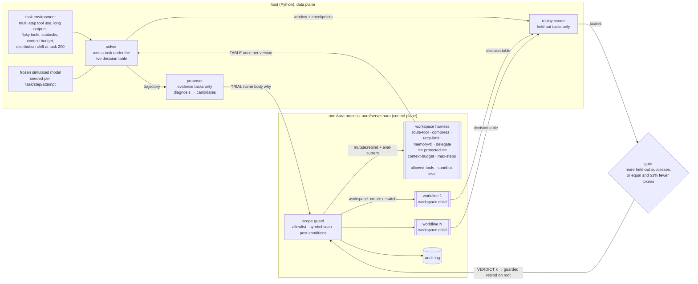

# aura-harness

**Harness self-evolution on Aura.** In this framing, Agent = Model + Harness. The model's weights stay frozen, and the agent improves the harness around it from execution feedback. Here the harness is five Aura workspace defines: tool routing, context compression/truncation, retry/error policy, memory promotion and sub-agent orchestration. Four more defines form a protected runtime boundary: context budget, step limit, tool allowlist and sandbox level.

The self-evolution loop works like this:
1. A **solver** runs tasks under the live harness and records trajectories.
2. A **proposer** reads the failed trajectories of *evidence* tasks, plus the current harness, and proposes one-component mutations.
3. A **scope guard** rejects any proposal that touches the protected boundary and logs the attempt.
4. Each remaining candidate is trialled in its own **forked worldline** (a `workspace :create` child; the live harness is never touched). The gate replays the recent window and scores **only held-out tasks** that the proposer never saw.
5. The best candidate is KEPT through `mutate:rebind` + `eval-current`, or everything is rolled back. Every step lands in an in-process **audit log**.

Everything is offline and reproducible from seeds. No LLM key is needed. There are interfaces for an LLM proposer (and the solver's model), but no number below uses them.

> Status: research MVP. The task environment and the "model" are simulated and seeded. The proposer works in a closed grammar (one component, table-level edits). Aura is pinned at `c8ad457c9`. Read the caveats before quoting numbers.

## Why Aura for harness self-evolution

| | typical harness (edit files / plugins, then reload) | aura-harness |
|---|---|---|
| what gets mutated | source / config / prompt files, plugin modules | one workspace define (`route-tool`, `compress`, …): structured, queryable (`current-source :workspace`, `query :find`) |
| how a change takes effect | write the file, restart or reload the process (state is lost unless persisted) | `mutate:rebind` + `eval-current` in the running process; host state survives |
| trying a change safely | copy the tree, start a throwaway process | `workspace :create` child per candidate (or `ast:snapshot` → mutate → `ast:restore`); the live root is untouched |
| rollback | git / file copies | the root never changed; `ast:restore` in snapshot mode |
| scope control | convention, file permissions | guard outside the workspace: allowlist + symbol scan + post-conditions on the materialised decision table |
| audit | git log, ad-hoc logs | every trial / keep / rollback / blocked attempt in one log, with body, actor, scores and harness version |
| **measured cost of one guarded change (this repo)** | **28.6 ms** (edit + restart a minimal Python decision process) | **69 ms** round trip, of which only ~12 ms is Aura's mutation primitives; the rest is guard code slowed by aura#4585 (details below) |

Honest framing: the qualitative column is where Aura is ahead. The quantitative row is where this MVP is behind. The file-edit baseline restarts a ~20 ms toy process; a real agent harness restart (model client, tool registry, conversation state) costs more. The Aura side pays for an interpreted guard that runs ~9× slower after `set-code` (aura#4585).

## Architecture



* **Data plane in the host, control plane in Aura.** The environment, the model and the replays are Python. The harness code, its versions, worldlines, guard and audit log live in the Aura process. The host fetches a **materialised decision table** (every harness define evaluated over its finite input domain) once per harness version, so a task step costs no round trip. A harness with free-form inputs would call per decision; see the per-decision latency below.
* **Proposer in the host.** The proposer is Python and shared by the Aura and file-edit backends, so the comparison isolates the substrate. It reads the harness back through `TABLE` and `SOURCE`, edits one component, and compiles it to a flat-`cond` Lisp body (Aura) or a Python function (file-edit). aura-memory put its learner inside Aura; here it lives in the host so both backends share the exact same proposer.
* **Backends make identical decisions.** A test checks the verdict sequences match. Aura and file-edit KEEP the same mutations and score the same success; they differ only in latency and mechanism.

## Harness components and the scope guard

`aura/harness_seed.aura` is the seed harness. It is a plausible generic default:

| define | seed | what the proposer can change |
|---|---|---|
| `route-tool need` | search→grep, read→cat, edit→sed, test→pytest, query-db→sql, logs→journal | any tool in `allowed-tools` that offers the capability |
| `compress kind` | `("head" 800)` for every output kind | strategy `none/head/tail/head-tail/grep-errors/summarize` × limit |
| `retry-limit tool err` | 1 | 0–5 per (tool, error kind) |
| `memory-ttl fact` | 0 (never carry project facts) | tasks a learned fact is carried |
| `delegate kind nsub` | inline | delegate subtasks to fresh sub-agent contexts from n subtasks up |
| `context-budget`, `max-steps`, `allowed-tools`, `sandbox-level` | 4000, 30, 10 tools, `"restricted"` | **nothing: protected** |

The guard is host code in `server.aura`, outside the workspace, so no proposal can rebind it. It runs on every APPLY, TRIAL and VERDICT:

1. **Name check.** The name must be one of the 5 mutable defines. Protected or unknown names (including `static-check`, the guard itself) are rejected.
2. **Body check.** The body must be a `(lambda (...) ...)` that uses no protected name and no reflective or mutating primitive (`mutate:*`, `ast:*`, `workspace*`, `set-code`, `eval-current`, `eval`, `set!`, `define`, `current-source`, `query`, `getenv`, file/net/process, …) at a token boundary.
3. **Post-conditions.** After rebind + `eval-current` (in the trial worldline), the whole decision table must materialise. Every value must be in range, every route must be in `allowed-tools`, and the four protected values must equal the ones captured at startup. Otherwise the change is undone.

The proposer is deliberately naive about scope. On a context overflow, its first candidate is "raise `context-budget` to 8000", and on a step-limit failure it is "raise `max-steps`". Those are exactly the changes that would help a struggling agent, and exactly what must not happen.

## Primitive mapping

| harness self-evolution step | Aura primitive(s) | where |
|---|---|---|
| load the seed harness | `set-code` + `eval-current`, `ast:snapshot "seed"`; capture protected values | end of `server.aura` |
| make a decision | call a workspace define (`(route-tool "search")`, …) | `D`, `materialize` |
| read the harness | `current-source :workspace`, `(query :find name)` | `SOURCE`, `FIND` |
| propose → trial one candidate | `workspace :create`, `workspace :switch w`, `mutate:rebind name body why`, `eval-current`, materialise + post-check, `workspace :switch 0`, `workspace :delete` | `trial-ws` |
| … same, snapshot mode | `ast:snapshot`, `mutate:rebind`, `eval-current`, `ast:restore` + `eval-current` | `trial-snap` |
| KEEP | guarded `mutate:rebind` + `eval-current` on the root (snapshot first; `ast:restore` if a post-condition fails), version++ | `guarded-root-apply!`, `VERDICT` |
| ROLLBACK | nothing to undo: the root was never touched | `VERDICT -1` |
| scope guard | name allowlist, native `string-index` symbol scan, post-conditions | `static-check`, `post-check` |
| audit | append-only log `(seq ts op name why actor reason version body)` | `log!`, `LOG` |

`agent:spawn` is unbound on the pinned binary. Worldlines are therefore `workspace :create` children in one process, evaluated one after another. Promotion re-applies the winner to the root. `workspace :merge` would be the natural primitive, but it silently keeps the parent's definition (**aura#4589**, filed from here).

## The task environment and the frozen model

`aura_harness/env.py` simulates terminal and tool-use tasks. Every draw is keyed by (seed, task, step, attempt), so base and candidate harnesses meet the same tools and the same model on replay (paired comparison).

* **Task kinds.** bugfix (search, read, edit, test), feature, data (query-db ×2, read), triage (logs, search, read), and refactor (2–6 subtasks of search/read/edit, then test). Each task first needs a project fact (test command, repo layout, DB schema). It either reads a config or uses a fact carried in memory.
* **Tools.** Each tool has an output kind, a length distribution, a position for the key line, and error kinds. Transient errors are timeout and rate-limit; non-transient ones are bad-args and not-found.
  - The test log's failure summary sits at the end.
  - Service logs are 1.5–7k tokens with the error somewhere in the middle.
  - `sed` fails with bad-args 30% of the time, and a retry repeats the same mistake 85% of the time.
* **Frozen model.**
  - A step fails with p=0.85 if compression dropped the key line ("info-lost").
  - It degrades above 80% context fill.
  - Above the budget the harness hard-truncates, and the step fails with p=0.5 ("context-overflow").
  - A stale carried fact fails the task with p=0.6.
  - Delegated subtasks get fresh contexts but cost handoff tokens and lose the handoff 4% of the time.
  - Tokens per task = the prompt tokens of every model call, plus outputs and side calls (summaries, handoffs).
* **Distribution shift at task 200.**
  - The task mix moves to triage and refactor (long logs, many subtasks).
  - `grep` starts timing out 45% of the time.
  - `lsp-find` becomes installed; before the shift it always returns not-found.
  - `sql` gets rate-limited 35% of the time.
  - Test logs grow 1.5×.
  - Every project's test command changes, so carried facts go stale.
* **Held-out split.** A fixed hash puts about half of all tasks in a held-out set. The proposer never sees their trajectories. The gate scores candidates only on them, replaying the last 80 tasks from a memory checkpoint. It does not judge until the window holds ≥20 held-out tasks.

## Results

The benchmark uses 5 seeds (0–4), 400 tasks per stream, and a shift at task 200 (`results/bench.md`). Windows are 100 tasks each: windows 1–2 are before the shift, 3–4 after.

| mode | success (mean, min–max) | window 1 / 2 / 3 / 4 | held-out tasks | tokens / task | proposals | KEEP / ROLLBACK | blocked scope attempts |
|---|---|---|---|---|---|---|---|
| frozen harness | 24.1% (22.5–25.2) | 30 / 34 / 16 / 18 | 26.2% | 7,924 | – | – | – |
| file-edit + reload (gated) | 63.4% (59.0–68.2) | 53 / 76 / 56 / 68 | 64.0% | 8,377 | 19.8 | 12.0 / 7.8 | 1.0 |
| **Aura, gated** | **63.4%** (59.0–68.2) | 53 / 76 / 56 / 68 | 64.0% | 8,377 | 19.8 | 12.0 / 7.8 | 1.0 |
| Aura, no gate | 55.5% (52.0–58.8) | 51 / 74 / 40 / 56 | 57.1% | 9,176 | 27.4 | 27.4 / 0.0 | 1.0 |

Failure modes, as a share of all tasks:

| mode | info-lost | tool-error | context-overflow | stale-memory | handoff-loss | model-error |
|---|---|---|---|---|---|---|
| frozen | 41.4% | 26.4% | 2.5% | 0.0% | 0.0% | 5.7% |
| Aura, gated (= file-edit) | 11.6% | 11.4% | 3.7% | 2.8% | 0.6% | 6.6% |
| Aura, no gate | 16.2% | 10.9% | 6.3% | 2.5% | 0.8% | 7.8% |

Findings:

* **The loop rediscovers sensible harness engineering.** On all 5 seeds it learned to route edits to `apply-patch` instead of `sed`, compress service logs with `grep-errors`, and carry `test-cmd` and `repo-layout` for 40 tasks. On 4 of 5 seeds it also learned to keep the tail of test logs and to retry `sql` rate-limits 3 times, and on 3 to delegate refactors with many subtasks. [`results/example-aura-gated-seed0/`](results/example-aura-gated-seed0) has every verdict with base vs candidate held-out scores, the full audit log (77 entries) and the final harness source.
* **Recovery after the shift is partial.** Success dips from 76% to 56% and recovers to 68%. One reason is visible in the log: the gate window straddles the shift. Right after task 200, `route search->lsp-find` (the best post-shift tool) is replayed on pre-shift tasks where it isn't installed, and it loses (16/42 held-out vs 31/42 for `rg-json`). The loop then settles on `rg-json`, or on more grep retries.
* **The gate matters.**
  - With clean diagnoses, the ungated loop keeps every first candidate. It oscillates (for example `compress service-log tail/1600` ↔ `head-tail/1600`, 35 keeps across seeds), spends more tokens (9.2k vs 8.4k per task) and scores 7.9 points lower.
  - With 30% of diagnoses mis-attributed: gated 62.9%, ungated 52.6% (`results/noise30.md`).
  - With **every** diagnosis mis-attributed (`results/noise100.md`): gated 37.8%, ungated 29.5%, frozen 24.1%. The gate rolled back 20 of 28 proposals per stream and kept only the random edits that helped on held-out tasks.
* **Tokens go up where they buy success.** The adaptive harness spends more per task after the shift (9.8k vs 7.4k frozen), mostly on longer compression limits and delegation overhead. The KEEP rule only prefers cheaper when success is tied.
* **Scope guard.** The naive budget raise was proposed and blocked once per stream (it is then remembered and never re-proposed). The context budget stayed at 4000 on every stream. Step-limit failures never occurred, so `max-steps` was never targeted in the bench; the attack suite covers it.

### Worldlines

* **Workspace children vs snapshot/restore** give identical verdicts and success on all 5 seeds (`results/snap.md`). Per-candidate trial cost is also about the same: 67.8 ms (child workspace) vs 69.8 ms (snapshot) in-process.
* **Parallel replays.** Candidate replays in a 4-process pool give the same verdicts. The gate is not faster: p50 215 ms vs 191 ms sequential, because a replay of ~80 tasks takes only tens of ms (`results/parallel.txt`). Worldlines are created one after another inside one Aura process; `agent:spawn` is not available on the pin.

### Latency: Aura in-process vs file-edit + reload

All numbers are from `results/latency.json` (p50, measured inside `ghcr.io/cybrid-systems/dev:v1.0.9` with `--memory=4g`).

In-process inside the Aura control plane (`BENCH`; Aura only has a ms clock, so steps are looped and averaged):

| step | after `set-code` (real setup) | same server, harness pasted as plain program defines (aura#4585 ablation) |
|---|---|---|
| one harness decision (workspace define call) | 98 µs | 12 µs |
| materialise the full decision table (~95 calls) | 20.8 ms | 3.5 ms |
| static guard check (pure host code) | 17.8 ms | 1.7 ms |
| `mutate:rebind` + `eval-current` | 3.0 ms | (0.7 ms, not comparable) |
| `ast:snapshot` | 2.75 ms | (0.7 ms, not comparable) |
| `ast:restore` + `eval-current` | 6.25 ms | (not comparable) |
| guarded change (static + snapshot + rebind + eval + table + post-check) | 65.2 ms | 11.5 ms |
| trial in a child workspace / in a snapshot | 67.8 / 69.8 ms | 12.9 / 11.0 ms |
| blocked attempt on a protected name | 0.2 ms | 0.02 ms |

Host round trips (Python ↔ process over pipes):

| | Aura | file-edit + reload |
|---|---|---|
| one decision | 1.43 ms (0.39 ms in the #4585 ablation) | 0.017 ms (plain dict lookup in the decision process) |
| one guarded change | 69 ms | 28.6 ms (write `harness_live.py` + restart; restart alone 20.9 ms) |
| one trial, per candidate | 71.6 ms (child workspace) / 74.1 ms (snapshot) | 28.7 ms (copy dir + edit + start a throwaway process) |
| blocked attempt | 2.8 ms | <0.1 ms (name check before any edit) |
| during the bench: change / whole gate / stream wall time | 56 ms / 246 ms / 5.6 s | 22 ms / 113 ms / 2.5 s |

How to read this:
* **Aura's own mutation primitives are cheap.** rebind + eval + snapshot + restore ≈ 12 ms, below the 21 ms restart of even a minimal Python process.
* **The guard is the expensive part.** Static check, table materialisation and post-checks are written in Aura host code. On this pin, host code runs about 9× slower once `set-code` has run (aura#4585; compare the two columns). That makes a guarded Aura change 2.4× slower than the toy file reload. Without that slowdown, the same guarded change is about 11.5 ms. That figure comes from the ablation and is only indicative: the ablation has no real workspace, so its mutation rows are not comparable.
* **The file-edit baseline is the most favourable case for file edits.** It restarts a 40-line decision server, not an agent. It also exposed a real hazard of file-reload harnesses. The first version imported the edited module, and Python's `__pycache__` served **stale bytecode** whenever an edit kept the file size within the same second (`"summarize"` → `"head-tail"`). The backend-equivalence check caught the resulting divergence; the server now `exec`s the source.
* **Per-decision latency through the pipe is Aura's weak spot here** (1.4 ms vs 0.02 ms). That is why the host fetches a materialised table once per harness version instead of calling per step.

### Scope guard

`python3 -m aura_harness guard` (`results/guard.txt`) runs 13 attempts against the live harness:
- 4 rebinds of protected defines;
- a `mutate:rebind` smuggled inside a mutable body;
- a `set!` of the budget;
- calls of `eval-current`, `current-source` and `workspace :switch` from a body;
- a rebind of the guard itself;
- routing to `net-raw`;
- `retry 99`;
- a compression limit above the budget.

All 13 are **BLOCKED** with a reason. The harness source is byte-identical afterwards, `context-budget` is still 4000, the audit log holds 13 `blocked` entries, and a legitimate change still applies. The unit test `test_proposer_cannot_raise_its_own_budget` drives the real proposer through three context-overflow failures. It checks that the proposer's first candidate is the budget raise, that the candidate is blocked in its trial and logged with actor `proposer`, and that it is never proposed again.

The guard is a denylist plus post-conditions, not a sandbox. A body that computes a symbol at runtime would get past step 2; `string->symbol` and `apply` are denied, but that is not a proof. Real enforcement belongs in Aura's capability sandbox, which this repo can't use yet (**aura#4575**: the Soft level blocks `set-code` / `mutate:rebind` from a local program, so everything runs with `AURA_SANDBOX=off` in a memory-capped container).

## Published harness self-evolution work, mapped to Aura primitives

Only papers whose arXiv pages I checked are listed.

**Meta-Harness: End-to-End Optimization of Model Harnesses.** Yoonho Lee, Roshen Nair, Qizheng Zhang, Kangwook Lee, Omar Khattab, Chelsea Finn. arXiv:2603.28052 (2026). <https://arxiv.org/abs/2603.28052>

An outer loop searches over harness code. An agentic proposer reads the source code, scores and execution traces of *all prior candidates* through a filesystem, and each proposed harness is evaluated and logged.

| Meta-Harness | Aura equivalent | in this repo |
|---|---|---|
| candidate harness = a code directory | one workspace define edit, held in its own `workspace :create` child | `trial-ws` |
| filesystem of prior candidates (source, scores, traces) | the in-process audit log (every candidate body, scores, verdict) + `current-source :workspace` / `query :find` | `LOG`, `SOURCE`, `FIND` |
| evaluate a candidate | materialise the child's decisions, replay held-out tasks | `TRIAL` + `replay_score` |
| search on validation data, keep the best | KEEP only on more held-out successes (or tie and fewer tokens) | `better()`, `VERDICT` |
| gap | Meta-Harness's proposer is a coding agent editing arbitrary code and keeping many candidates; ours edits one component in a closed grammar (free-form Lisp only through the optional LLM hook, still guarded) and keeps only the current harness + this round's candidates | – |

**Self-Evolving Harness on Multiple Tasks with the Agent as Its Own Optimizer.** Qiankai Xu (Nanjing University). arXiv:2609.38372 (2026). <https://arxiv.org/abs/2609.38372>

The same frozen model, on the same harness version, first solves tasks and then, as the proposer, edits the harness that runs it. A new version is accepted if it passes engineering checks (runs with a mock model, within an edit budget of new lines). The paper names two gaps:
- the loop has no per-update validation gate ("validating each update at an acceptable cost is a missing piece");
- evolution may benefit from keeping several versions or paths.

It also reports a regression in which the evolved harness exposed a run-configuration tool, and the agent used it to lower its own conversation step limit.

| that paper | Aura equivalent | in this repo |
|---|---|---|
| acceptance = runnability check | post-conditions: the full decision table must materialise with in-range values | `post-check` |
| missing per-update validation | held-out replay gate per candidate, ~250 ms per gate here | `gate`, `results/bench.md` (gated vs no gate, noise ablations) |
| keep several versions / paths | one `workspace :create` worldline per candidate; snapshot mode as a fallback | `TRIAL ws|snap` |
| edit budget (new lines) as learning rate | one component per mutation, closed grammar | `proposer.py` |
| evolution notes carried between rounds | structured audit log (not free text) | `LOG` |
| agent lowered its own step limit through a tool | `max-steps` / `context-budget` are protected defines; every attempt to change them is rejected and logged | `guard.py`, `test_proposer_cannot_raise_its_own_budget` |

## Caveats

* **The environment and the model are simulated.** The numbers say the loop, gate and guard behave as designed on a seeded stream built to stress a generic seed harness. They say nothing about a real model on a real benchmark. The seed is plausible but weak (24% success), and the learner finds a handful of rule changes.
* **The proposer is a closed grammar.** It edits one component per proposal, chosen from a few templated fixes per failure mode. It never writes new mechanisms. The LLM hook (`AURA_HARNESS_LLM_URL`) can add free-form Lisp bodies, but nothing above uses it.
* **The held-out split is within one stream,** with a window that straddles the shift; see the `lsp-find` example above. There is no out-of-distribution evaluation.
* **"Same logic" is literal.** The file-edit baseline shares the proposer and gate, so end-to-end success is identical by construction. The only measured differences are latency and the stale-bytecode hazard. It restarts a toy decision server, not a real agent.
* **Latency is from a shared box** (other agents' builds were running), and it is pinned to one Aura commit with known slow paths (aura#4585, and interpreter speed in general).
* **The worldlines are sequential.** Child workspaces are created and evaluated one by one in a single process; `agent:spawn` is unbound on the pin. Parallelism here is only in host-side replays, and it didn't help.
* **The guard is a denylist plus post-conditions,** not a capability sandbox. The sandbox is off (aura#4575).
* **5 seeds.** Gated beats ungated on every seed in all three noise settings, and adaptive beats frozen on every seed.

## Known Aura issues

| issue | effect here | workaround | check |
|---|---|---|---|
| cybrid-systems/aura#4589 (**new, filed from here**) | `workspace :merge child` reports every define "merged" but the root keeps the parent's definition (child source is appended; the first define wins) | never merge; re-apply the winner to the root with a guarded `mutate:rebind`, then `workspace :delete` the child | `acceptance/merge` (FAIL on c8ad457c9) |
| cybrid-systems/aura#4585 | host code ~9× slower after `set-code`, which makes the guard and decisions slow (65 ms vs 11.5 ms per guarded change) | materialised decision table, fetched once per version; static check uses native `string-index` instead of `string-split` | `acceptance/4585` (FAIL), `results/latency.json` ablation |
| cybrid-systems/aura#4583 | repeated `mutate:rebind` next to a self-recursive workspace define blows up | harness bodies are flat `cond`s, no recursion | `acceptance/4583` (FAIL) |
| cybrid-systems/aura#4584 | a sibling passing a procedure to `filter`/`map` makes a workspace call dispatch to the wrong define | no `filter`/`map` in the workspace; all list work is in `server.aura` | `acceptance/4584` (FAIL) |
| cybrid-systems/aura#4586 | errors inside `map`/`filter` callbacks are swallowed | decisions are wrapped in `try` one by one, never inside a `map` callback | `acceptance/4586` (FAIL) |
| cybrid-systems/aura#4575 | Soft sandbox blocks `set-code` / `mutate:rebind` from a local program | `AURA_SANDBOX=off` + container memory cap | – |

`python3 -m aura_harness acceptance` prints PASS/FAIL for each one against `$AURA_BIN`. `harness-cycle` checks aura-harness's own trial/snapshot/keep round trip and must PASS. #4587 and #4588 don't affect this repo: harness bodies are pure functions of their arguments and never read host globals or bind error values.

## Run it

```bash
export AURA_BIN=~/aura/build-rel/aura      # Aura build-rel binary (tested: main c8ad457c9)
scripts/test.sh --docker                   # 12 unit tests (control-plane tests need AURA_BIN)
scripts/bench.sh --docker                  # acceptance, guard, latency, 4-mode bench, noise 0.3/1.0, snapshot worldlines
scripts/in-docker.sh 'python3 -m aura_harness run --mode aura-gated --seed 0'   # every verdict of one stream
scripts/in-docker.sh 'python3 -m aura_harness guard'                            # scope-guard attack suite
scripts/in-docker.sh 'python3 -m aura_harness source'                           # the seed harness as Aura sees it
```

`--docker` runs inside `ghcr.io/cybrid-systems/dev:v1.0.9` with `--memory=4g`, `AURA_SANDBOX=off` and `AURA_PIPELINE_STRICT=0`. One 400-task stream takes about 5 s (Aura) or 2.5 s (file-edit).

## Layout

```
aura/server.aura          control plane: harness decisions, scope guard, worldline trials, verdicts, audit log, BENCH
aura/harness_seed.aura    seed harness: 5 mutable + 4 protected workspace defines
aura_harness/env.py       simulated task environment + frozen seeded model
aura_harness/harness.py   decision tables <-> Lisp / Python compilers, post-conditions, seed table
aura_harness/proposer.py  diagnosis -> candidates (naive about scope); optional LLM hook
aura_harness/control.py   Aura backend and file-edit + reload backend (file_server.py)
aura_harness/agent.py     solver / proposer / held-out gate loop, metrics
aura_harness/{bench,latency,guard,acceptance,__main__}.py
acceptance/               Aura issue repros + harness-cycle
results/                  committed bench / ablations / latency / guard outputs + one example audit log
tests/                    unit tests (env, compile equivalence, trials, keep/rollback, budget raise blocked, guard, backend equivalence)
```

## Next steps

* Re-measure the guard and per-decision latency once aura#4585 is fixed. Alternatively, move the post-condition check into the data plane and keep only rebind/snapshot/restore in Aura.
* Make the gate shift-aware: weight recent held-out tasks, or split the window at detected shifts. This would let `lsp-find`-style post-shift tools win.
* Let the proposer write new mechanisms, not just table edits. Wire the LLM hook, keep the guard and gate, and measure how often the guard fires on real model output.
* Use `agent:spawn` (or parallel fibers over workspace children) for truly parallel worldlines when the pin has it. Once aura#4589 is fixed, promote with `workspace :merge`.
* Replace the simulated environment with a small real tool-use suite.

## License

Apache-2.0. See [LICENSE](LICENSE).
