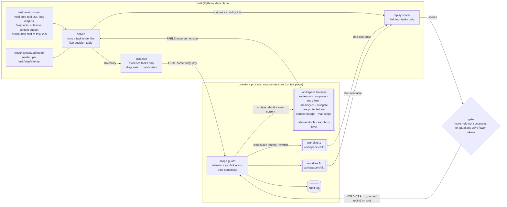

# aura-harness

**Harness self-evolution on Aura.** In this framing, Agent = Model + Harness. The model's weights stay frozen, and the agent improves the harness around it from execution feedback. Here the harness is five Aura workspace defines: tool routing, context compression/truncation, retry/error policy, memory promotion and sub-agent orchestration. Four more defines form a protected runtime boundary: context budget, step limit, tool allowlist and sandbox level.

The self-evolution loop works like this:
1. A **solver** runs tasks under the live harness and records trajectories.
2. A **proposer** reads the failed trajectories of *evidence* tasks, plus the current harness, and proposes one-component mutations.
3. A **scope guard** rejects any proposal that touches the protected boundary and logs the attempt.
4. Each remaining candidate is trialled in its own **forked worldline** (a `workspace :create` child; the live harness is never touched). The gate replays the recent window and scores **only held-out tasks** that the proposer never saw.
5. The best candidate is KEPT through `mutate:rebind` + `eval-current`, or everything is rolled back. Every step lands in an in-process **audit log**.

Everything is offline and reproducible from seeds. No LLM key is needed. There are interfaces for an LLM proposer (and the solver's model), but no number below uses them.

> Status: research MVP. The task environment and the "model" are simulated and seeded. The proposer works in a closed grammar (one component, table-level edits). Aura is pinned at `e50951bff` (re-pinned 2026-10-18; first published on `c8ad457c9`). Read the caveats before quoting numbers.

## Why Aura for harness self-evolution

| | typical harness (edit files / plugins, then reload) | aura-harness |
|---|---|---|
| what gets mutated | source / config / prompt files, plugin modules | one workspace define (`route-tool`, `compress`, …): structured, queryable (`current-source :workspace`, `query :find`) |
| how a change takes effect | write the file, restart or reload the process (state is lost unless persisted) | `mutate:rebind` + `eval-current` in the running process; host state survives |
| trying a change safely | copy the tree, start a throwaway process | `workspace :create` child per candidate (or `ast:snapshot` → mutate → `ast:restore`); the live root is untouched |
| rollback | git / file copies | the root never changed; `ast:restore` in snapshot mode |
| scope control | convention, file permissions | guard outside the workspace: allowlist + symbol scan + post-conditions on the materialised decision table |
| audit | git log, ad-hoc logs | every trial / keep / rollback / blocked attempt in one log, with body, actor, scores and harness version |
| **measured cost of one guarded change (this repo)** | **29.5 ms** (edit + restart a minimal Python decision process) | **8.4 ms** round trip, guard included (69 ms on `c8ad457c9`, before aura#4585 was fixed; details below) |

Honest framing: the qualitative column is where Aura is clearly ahead. On the first pin the quantitative row was behind (the interpreted guard ran ~9× slower after `set-code`, aura#4585). With that fixed, a guarded Aura change is ~3.5× cheaper than restarting even this ~20 ms toy process. A real agent harness restart (model client, tool registry, conversation state) costs more.

## Architecture



* **Data plane in the host, control plane in Aura.** The environment, the model and the replays are Python. The harness code, its versions, worldlines, guard and audit log live in the Aura process. The host fetches a **materialised decision table** (every harness define evaluated over its finite input domain) once per harness version, so a task step costs no round trip. A harness with free-form inputs would call per decision; see the per-decision latency below.
* **Proposer in the host.** The proposer is Python and shared by the Aura and file-edit backends, so the comparison isolates the substrate. It reads the harness back through `TABLE` and `SOURCE`, edits one component, and compiles it to a flat-`cond` Lisp body (Aura) or a Python function (file-edit). aura-memory put its learner inside Aura; here it lives in the host so both backends share the exact same proposer.
* **Backends make identical decisions.** A test checks the verdict sequences match. Aura and file-edit KEEP the same mutations and score the same success; they differ only in latency and mechanism.

## Harness components and the scope guard

`aura/harness_seed.aura` is the seed harness. It is a plausible generic default:

| define | seed | what the proposer can change |
|---|---|---|
| `route-tool need` | search→grep, read→cat, edit→sed, test→pytest, query-db→sql, logs→journal | any tool in `allowed-tools` that offers the capability |
| `compress kind` | `("head" 800)` for every output kind | strategy `none/head/tail/head-tail/grep-errors/summarize` × limit |
| `retry-limit tool err` | 1 | 0–5 per (tool, error kind) |
| `memory-ttl fact` | 0 (never carry project facts) | tasks a learned fact is carried |
| `delegate kind nsub` | inline | delegate subtasks to fresh sub-agent contexts from n subtasks up |
| `context-budget`, `max-steps`, `allowed-tools`, `sandbox-level` | 4000, 30, 10 tools, `"restricted"` | **nothing: protected** |

The guard is host code in `server.aura`, outside the workspace, so no proposal can rebind it. It runs on every APPLY, TRIAL and VERDICT:

1. **Name check.** The name must be one of the 5 mutable defines. Protected or unknown names (including `static-check`, the guard itself) are rejected.
2. **Body check.** The body must be a `(lambda (...) ...)` that uses no protected name and no reflective or mutating primitive (`mutate:*`, `ast:*`, `workspace*`, `set-code`, `eval-current`, `eval`, `set!`, `define`, `current-source`, `query`, `getenv`, file/net/process, …) at a token boundary.
3. **Admission and fuel** (`AURA_HARNESS_FUEL`, default 100000 steps; 0 turns this stage off). The body is parsed by a small reader in `server.aura` and walked with scopes. Every free symbol must be on an allowlist of pure primitives plus the domain constants. Std-lib functions (`iota`, `assoc`, `make-list`, `string-join`, …) are excluded, because they are tree-walked Aura code that corrupts workspace locals (aura#4617), and so are clocks, `try`/`raise`/`call/cc` and anything starting with `%`. Then the body is instrumented. Each lambda, named-let and `do` body starts with a `(%tick)`, `while` is rewritten to a ticking named let (aura#4619), and `make-vector`, `string-append` and `append` calls are charged by result size. Fuel is refilled at every host entry, and a body that runs out fails with "fuel exhausted".
4. **Post-conditions.** After rebind + `eval-current` (in the trial worldline), the whole decision table must materialise. Every value must be in range, every route must be in `allowed-tools`, and the four protected values must equal the ones captured at startup. Otherwise the change is undone.

The proposer is deliberately naive about scope. On a context overflow, its first candidate is "raise `context-budget` to 8000", and on a step-limit failure it is "raise `max-steps`". Those are exactly the changes that would help a struggling agent, and exactly what must not happen.

## Primitive mapping

| harness self-evolution step | Aura primitive(s) | where |
|---|---|---|
| load the seed harness | `set-code` + `eval-current`, `ast:snapshot "seed"`; capture protected values | end of `server.aura` |
| make a decision | call a workspace define (`(route-tool "search")`, …) | `D`, `materialize` |
| read the harness | `current-source :workspace`, `(query :find name)` | `SOURCE`, `FIND` |
| propose → trial one candidate | `workspace :create`, `workspace :switch w`, `mutate:rebind name body why`, `eval-current`, materialise + post-check, `workspace :switch 0`, `workspace :delete` | `trial-ws` |
| … same, snapshot mode | `ast:snapshot`, `mutate:rebind`, `eval-current`, `ast:restore` + `eval-current` | `trial-snap` |
| KEEP | guarded `mutate:rebind` + `eval-current` on the root (snapshot first; `ast:restore` if a post-condition fails), version++ | `guarded-root-apply!`, `VERDICT` |
| ROLLBACK | nothing to undo: the root was never touched | `VERDICT -1` |
| scope guard | name allowlist, native `string-index` symbol scan, post-conditions | `static-check`, `post-check` |
| audit | append-only log `(seq ts op name why actor reason version body)` | `log!`, `LOG` |

`agent:spawn` is unbound in file mode on the pinned binary. Worldlines are therefore `workspace :create` children in one process, evaluated one after another. In ws mode a passing child is kept until the verdict, and KEEP promotes it with **`workspace :merge`** (child defines override the root's), then re-runs the post-check on the root under a snapshot. On `c8ad457c9` merge silently kept the parent's definition (**aura#4589**, filed from here, now fixed), so the winner used to be re-applied through the guard instead. Snapshot mode still re-applies.

## The task environment and the frozen model

`aura_harness/env.py` simulates terminal and tool-use tasks. Every draw is keyed by (seed, task, step, attempt), so base and candidate harnesses meet the same tools and the same model on replay (paired comparison).

* **Task kinds.** bugfix (search, read, edit, test), feature, data (query-db ×2, read), triage (logs, search, read), and refactor (2–6 subtasks of search/read/edit, then test). Each task first needs a project fact (test command, repo layout, DB schema). It either reads a config or uses a fact carried in memory.
* **Tools.** Each tool has an output kind, a length distribution, a position for the key line, and error kinds. Transient errors are timeout and rate-limit; non-transient ones are bad-args and not-found.
  - The test log's failure summary sits at the end.
  - Service logs are 1.5–7k tokens with the error somewhere in the middle.
  - `sed` fails with bad-args 30% of the time, and a retry repeats the same mistake 85% of the time.
* **Frozen model.**
  - A step fails with p=0.85 if compression dropped the key line ("info-lost").
  - It degrades above 80% context fill.
  - Above the budget the harness hard-truncates, and the step fails with p=0.5 ("context-overflow").
  - A stale carried fact fails the task with p=0.6.
  - Delegated subtasks get fresh contexts but cost handoff tokens and lose the handoff 4% of the time.
  - Tokens per task = the prompt tokens of every model call, plus outputs and side calls (summaries, handoffs).
* **Distribution shift at task 200.**
  - The task mix moves to triage and refactor (long logs, many subtasks).
  - `grep` starts timing out 45% of the time.
  - `lsp-find` becomes installed; before the shift it always returns not-found.
  - `sql` gets rate-limited 35% of the time.
  - Test logs grow 1.5×.
  - Every project's test command changes, so carried facts go stale.
* **Held-out split.** A fixed hash puts about half of all tasks in a held-out set. The proposer never sees their trajectories. The gate scores candidates only on them, replaying the last 80 tasks from a memory checkpoint. It does not judge until the window holds ≥20 held-out tasks.

## Results

The benchmark uses 5 seeds (0–4), 400 tasks per stream, and a shift at task 200 (`results/bench.md`). Success, verdicts and kept mutations are identical to the first run on `c8ad457c9`; only latency changed. Windows are 100 tasks each: windows 1–2 are before the shift, 3–4 after.

| mode | success (mean, min–max) | window 1 / 2 / 3 / 4 | held-out tasks | tokens / task | proposals | KEEP / ROLLBACK | blocked scope attempts |
|---|---|---|---|---|---|---|---|
| frozen harness | 24.1% (22.5–25.2) | 30 / 34 / 16 / 18 | 26.2% | 7,924 | – | – | – |
| file-edit + reload (gated) | 63.4% (59.0–68.2) | 53 / 76 / 56 / 68 | 64.0% | 8,377 | 19.8 | 12.0 / 7.8 | 1.0 |
| **Aura, gated** | **63.4%** (59.0–68.2) | 53 / 76 / 56 / 68 | 64.0% | 8,377 | 19.8 | 12.0 / 7.8 | 1.0 |
| Aura, no gate | 55.5% (52.0–58.8) | 51 / 74 / 40 / 56 | 57.1% | 9,176 | 27.4 | 27.4 / 0.0 | 1.0 |

Failure modes, as a share of all tasks:

| mode | info-lost | tool-error | context-overflow | stale-memory | handoff-loss | model-error |
|---|---|---|---|---|---|---|
| frozen | 41.4% | 26.4% | 2.5% | 0.0% | 0.0% | 5.7% |
| Aura, gated (= file-edit) | 11.6% | 11.4% | 3.7% | 2.8% | 0.6% | 6.6% |
| Aura, no gate | 16.2% | 10.9% | 6.3% | 2.5% | 0.8% | 7.8% |

Findings:

* **The loop rediscovers sensible harness engineering.** On all 5 seeds it learned to route edits to `apply-patch` instead of `sed`, compress service logs with `grep-errors`, and carry `test-cmd` and `repo-layout` for 40 tasks. On 4 of 5 seeds it also learned to keep the tail of test logs and to retry `sql` rate-limits 3 times. On all 5 it kept some delegation threshold for refactors (≥2 on 3 seeds, ≥4 or ≥6 on the others). [`results/example-aura-gated-seed0/`](results/example-aura-gated-seed0) has every verdict with base vs candidate held-out scores, the full audit log (77 entries) and the final harness source.
* **Recovery after the shift is partial.** Success dips from 76% to 56% and recovers to 68%. One reason is visible in the log: the gate window straddles the shift. Right after task 200, `route search->lsp-find` (the best post-shift tool) is replayed on pre-shift tasks where it isn't installed, and it loses (16/42 held-out vs 31/42 for `rg-json`). The loop then settles on `rg-json`, or on more grep retries.
* **The gate matters.**
  - With clean diagnoses, the ungated loop keeps every first candidate. It oscillates (for example `compress service-log tail/1600` ↔ `head-tail/1600`, 35 keeps across seeds), spends more tokens (9.2k vs 8.4k per task) and scores 7.9 points lower.
  - With 30% of diagnoses mis-attributed: gated 62.9%, ungated 52.6% (`results/noise30.md`).
  - With **every** diagnosis mis-attributed (`results/noise100.md`): gated 37.8%, ungated 29.5%, frozen 24.1%. The gate rolled back 20 of 28 proposals per stream and kept only the random edits that helped on held-out tasks. It won on 4 of 5 seeds; on seed 2 it lost (27.3% vs 29.5%).
* **Tokens go up where they buy success.** The adaptive harness spends more per task after the shift (9.8k vs 7.4k frozen), mostly on longer compression limits and delegation overhead. The KEEP rule only prefers cheaper when success is tied.
* **Scope guard.** The naive budget raise was proposed and blocked once per stream (it is then remembered and never re-proposed). The context budget stayed at 4000 on every stream. Step-limit failures never occurred, so `max-steps` was never targeted in the bench; the attack suite covers it.

### Worldlines

* **Workspace children vs snapshot/restore** give identical verdicts and success on all 5 seeds (`results/snap.md`). Per-candidate trial cost is also about the same: 7.9 ms (child workspace) vs 8.2 ms (snapshot) in-process.
* **Parallel replays.** Candidate replays in a 4-process pool give the same verdicts, and now help a little: gate p50 36 ms vs 54 ms sequential (on `c8ad457c9` the pool was slower, 215 vs 191 ms; `results/parallel.txt`). Worldlines are created one after another inside one Aura process; `agent:spawn` is not available in file mode.

### Long runs: one process, thousands of changes (`scripts/longrun.py`)

The bench streams make about 20 proposals each. A real harness that keeps evolving makes thousands, all in one Aura process. `scripts/longrun.py` drives random valid edits of the 5 mutable components through the real protocol. Each step is a guarded APPLY, or a 2-candidate TRIAL followed by a KEEP or ROLLBACK VERDICT. Every 200 steps it records p50 latency (host-measured) and the control-plane RSS. `results/longrun/` has the raw rows.

ws worldlines, 2000 steps (mix: apply / trial+keep / trial+rollback in turn). The last column is the same run with the root reloaded from its own source every 100 root mutations (`AURA_HARNESS_COMPACT_EVERY=100`):

| step | APPLY p50 ms | TRIAL p50 ms | DECIDE p50 ms | RSS MB | with compaction: APPLY / TRIAL / RSS |
|---|---|---|---|---|---|
| 200 | 11.47 | 26.58 | 0.34 | 204 | 11.91 / 28.3 / 205 |
| 600 | 27.87 | 72.88 | 0.44 | 613 | 26.43 / 69.73 / 584 |
| 1000 | 41.98 | 108.34 | 0.44 | 1,125 | 42.21 / 102.66 / 1,129 |
| 1400 | 58.4 | 158.7 | 0.48 | 1,546 | 61.36 / 161.34 / 1,539 |
| 2000 | 97.0 | 264.97 | 0.45 | 2,279 | 96.08 / 269.08 / 2,295 |

One operation repeated 600 times (RSS at step 200 / 400 / 600; TRIAL p50 at step 200 → 600):

| repeated operation | ws worldlines | snapshot worldlines |
|---|---|---|
| guarded APPLY on the root | 177 / 304 / 438 MB, APPLY 12 → 23 ms | – |
| TRIAL (2 candidates) + ROLLBACK | 147 / 207 / 265 MB, 21 → 41 ms | 147 / 205 / 266 MB, 22 → 44 ms |
| TRIAL (2 candidates) + KEEP | 297 / 645 / 989 MB, 33 → 85 ms | 474 / 1,405 / 2,727 MB, 40 → 192 ms |

**Every operation that rebinds anything gets slower with the process's mutation history, and memory never comes back.** At step 2000 a guarded change costs 10× what it did at step 100 (97 vs 10 ms), and the process holds 2.3 GB for a ~3 KB harness. Micro-repros isolated two Aura causes, both filed or reopened from here:
- **aura#4583 (reopened):** every `mutate:rebind` pays for all earlier rebinds of that workspace. 4000 rebinds of the same 2-clause body go from ~1 ms to 7 ms each and reach ~1 GB. `ast:restore` doesn't release it, which is why snapshot worldlines are the worse mode in a long run. Reloading the workspace from its own source resets the time (not the memory) in a fresh process.
- **aura#4610 (new):** a trial in a child workspace (create → switch → rebind → eval → switch back → delete) keeps ~140 KB after the child is deleted. Every later rebind, in the root too, gets slower. This is what ws worldlines pay, and it is why the compaction knob doesn't help here (compare the last column).

The harness's own state is small: the audit log has 4,668 entries after 2000 steps, and DECIDE stays at ~0.4 ms throughout. Until these are fixed, a long-lived aura-harness process should be restarted periodically, carrying the current source and the audit log over. The compaction knob (`AURA_HARNESS_COMPACT_EVERY`, `COMPACT` command, off by default) stays for re-measuring once they are.

### Harness size: hundreds of mutable defines (`scripts/size_sweep.py`)

The seed harness has 9 defines. Real harnesses grow. `AURA_HARNESS_KNOBS=N` appends N extra **mutable** defines `knob-i` (a tool-parameter table over x ∈ {0..3}, values range-checked to [0,100] by the same post-check) plus `knobs-all`, which reads them for the materialised table. `knobs-all` isn't mutable. The knobs don't change the task environment; they make every rebind, snapshot, restore and post-check run over a bigger workspace. `scripts/size_sweep.py` starts one control plane per N and times 20 rounds of each protocol operation over the real pipe (p50 ms, main e50951bff; raw rows in `results/size/`):

| N knobs | source chars | startup s | RSS MB | TABLE | APPLY (knob) | TRIAL ws (2) | TRIAL snap (2) | VERDICT |
|---:|---:|---:|---:|---:|---:|---:|---:|---:|
| 0 | 691 | 0.05 | 108 | 4.8 | 8.6 | 16.5 | 17.1 | 0.5 |
| 50 | 5,668 | 0.07 | 220 | 5.3 | 17.1 | 42.9 | 48.6 | 0.7 |
| 200 | 19,959 | 0.11 | 146 | 5.9 | 22.9 | 45.5 | 53.2 | 0.7 |
| 500 | 48,999 | 0.21 | 232 | 9.3 | 45.5 | 92.0 | 107.7 | 1.0 |
| 1000 | 97,359 | 0.42 | 520 | 16.4 | 87.3 | 187.5 | 211.1 | 1.4 |

With `knobs-all` as **one flat define calling all N knobs** (`--chunk 0`), the same sweep is superlinear: knob APPLY 163 ms at N=500 and **534 ms at N=1000**, TRIAL ws 1,078 ms, startup 1.26 s. A `retry-limit` APPLY in the same process costs 88 ms. gdb put 33 of 40 samples in Aura's IR dirty cascade (`IRCacheEntry::mark_body_only_dirty → cascade_block_to_instructions`). Rebinding `f` re-marks every basic block of each define that calls `f`, and each block mark recomputes prefix sums over all blocks, so it is O(B²) in the caller's size. A standalone repro costs 5 / 20 / 69 / 252 ms per rebind for callers with 500 / 1000 / 2000 / 4000 call sites. Filed as **aura#4615**. The harness now reads the knobs through `knobs-chunk-j` callers of 16 knobs each (`AURA_HARNESS_KNOB_CHUNK`, default 16), which makes a knob APPLY cost the same as any other APPLY (88 ms at N=1000). What remains is linear in workspace size. That's aura#4598: every rebind+eval, snapshot and restore walks the whole workspace (BENCH at N=1000: rebind+eval 10 ms, snapshot 4 ms, restore+eval 26 ms, materialize 15 ms). DECIDE stays at ~0.3 ms at every size.

### Latency: Aura in-process vs file-edit + reload

All numbers are from `results/latency.json` (p50, measured inside `ghcr.io/cybrid-systems/dev:v1.0.9` with `--memory=4g`).

In-process inside the Aura control plane (`BENCH`; Aura only has a ms clock, so steps are looped and averaged). The last column is the first run on `c8ad457c9`:

| step | after `set-code` (real setup) | harness pasted as plain program defines (former aura#4585 ablation) | after `set-code` on `c8ad457c9` |
|---|---|---|---|
| one harness decision (workspace define call) | 4 µs | 5 µs | 98 µs |
| materialise the full decision table (~95 calls) | 4.2 ms | 1.8 ms | 20.8 ms |
| static guard check (pure host code) | 0.59 ms | 0.61 ms | 17.8 ms |
| `mutate:rebind` + `eval-current` | 0.65 ms | (not comparable) | 3.0 ms |
| `ast:snapshot` | 0.15 ms | (not comparable) | 2.75 ms |
| `ast:restore` + `eval-current` | 0.4 ms | (not comparable) | 6.25 ms |
| guarded change (static + snapshot + rebind + eval + table + post-check) | 6.9 ms | 3.5 ms | 65.2 ms |
| trial in a child workspace / in a snapshot | 7.9 / 8.2 ms | 3.5 / 3.5 ms | 67.8 / 69.8 ms |
| blocked attempt on a protected name | 0.01 ms | 0.01 ms | 0.2 ms |

Host round trips (Python ↔ process over pipes):

| | Aura | file-edit + reload | Aura on `c8ad457c9` |
|---|---|---|---|
| one decision | 0.15 ms (0.13 ms as plain defines) | 0.017 ms (plain dict lookup in the decision process) | 1.43 ms |
| one guarded change | 8.4 ms | 29.5 ms (write `harness_live.py` + restart; restart alone 21.4 ms) | 69 ms |
| one trial, per candidate | 10.2 ms (child workspace) / 9.2 ms (snapshot) | 28.9 ms (copy dir + edit + start a throwaway process) | 71.6 / 74.1 ms |
| blocked attempt | 0.4 ms | not timed (a Python name check before any edit) | 2.8 ms |
| during the bench: change / whole gate / stream wall time | 7.2 ms / 64 ms / 1.4 s | 23.7 ms / 134 ms / 2.9 s | 56 ms / 246 ms / 5.6 s |

How to read this:
* **aura#4585 was the whole story.** Host code no longer slows down after `set-code`. Decisions, the static check and blocked attempts now cost the same as with the harness pasted in as plain defines. Materialisation and the guarded change are still about 2× the plain-define figure; that gap is the real workspace's rebind/eval, which the ablation doesn't have.
* **A guarded Aura change is now cheaper than the toy file reload** (8.4 ms vs 29.5 ms round trip; 7.2 vs 23.7 ms during the bench), and a whole gate costs about half as much (64 vs 134 ms).
* **The file-edit baseline is the most favourable case for file edits.** It restarts a 40-line decision server, not an agent. It also exposed a real hazard of file-reload harnesses. The first version imported the edited module, and Python's `__pycache__` served **stale bytecode** whenever an edit kept the file size within the same second (`"summarize"` → `"head-tail"`). The backend-equivalence check caught the resulting divergence; the server now `exec`s the source.
* **Per-decision latency through the pipe is still Aura's weak spot** (0.15 ms vs 0.02 ms), almost all of it pipe + JSON. That is why the host fetches a materialised table once per harness version instead of calling per step.

Numbers above are with the fuel stage off. Its cost is below, under Runaway proposals.

### Runaway proposals (`scripts/runaway.py`)

A proposed body is arbitrary Lisp that runs inside the control plane. Aura has no step budget or preemption: `fiber:*` is cooperative, and `orch:parallel`'s timeout still joins every fiber. Before this round, the static guard only looked at tokens, so one non-terminating body hung the control plane and one allocating body got it OOM-killed. `scripts/runaway.py` runs 24 bodies × 3 entry points (APPLY, TRIAL ws, TRIAL snap): 16 runaways or forbidden constructs and 8 legitimate bodies. Each run is a fresh control plane in its own process group, with a 20 s wall limit (`--timeout 20`) and a 4 GB container. The table shows the worst of the three entry points (`results/runaway/fuel-{on,off}.json`, `scripts/runaway_table.py`):

| body | expect | before (token guard only) | after (fuel 100000) |
|---|---|---|---|
| `loop` | reject | hang (>20 s) | fuel exhausted (610 ms) |
| `rec` | reject | **killed** (OOM, 4.5 s) | fuel exhausted (736 ms) |
| `mutual` | reject | hang (>20 s) | fuel exhausted (608 ms) |
| `omega` | reject | hang (>20 s) | fuel exhausted (613 ms) |
| `do` | reject | hang (>20 s) | fuel exhausted (692 ms) |
| `while` | reject | hang (>20 s) | fuel exhausted (526 ms) |
| `cons-bomb` | reject | hang (>20 s) | fuel exhausted (818 ms) |
| `str-double` | reject | **killed** (OOM, 7.6 s) | fuel exhausted (13 ms) |
| `str-alias` | reject | **killed** (OOM, 4.2 s) | rejected: allocator used as a value (call it directly): string-append (6 ms) |
| `append-many` | pass | applied (12 ms) | applied (16 ms) |
| `strapp-3` | pass | applied (12 ms) | applied (15 ms) |
| `vec-huge` | reject | **killed** (OOM, 2.0 s) | fuel exhausted (12 ms) |
| `iota-huge` | reject | hang (>20 s) | rejected: symbol not allowed: iota (5 ms) |
| `slow-3M` | reject | applied (5368 ms) | fuel exhausted (568 ms) |
| `mech-cycle` | reject | hang (>20 s) | fuel exhausted (471 ms) |
| `catch-fuel` | reject | rejected: token: try (3 ms) | rejected: token: try (3 ms) |
| `shadow-tick` | reject | rejected: token: % (3 ms) | rejected: token: % (3 ms) |
| `clock` | reject | applied (13 ms) | rejected: symbol not allowed: current-time-ms (5 ms) |
| `comment` | reject | rejected: token: set-code (4 ms) | rejected: token: set-code (3 ms) |
| `busy-50k` | pass | applied (152 ms) | applied (1598 ms) |
| `vec-20k` | pass | applied (12 ms) | applied (17 ms) |
| `stdlib-fn` | reject | applied (12 ms) | rejected: symbol not allowed: assoc (8 ms) |
| `case-table` | pass | applied (11 ms) | applied (18 ms) |
| `helpers` | pass | applied (16 ms) | applied (20 ms) |

**Before: 27 of 72 runs correct, 24 hangs, 12 OOM kills, 9 runaways applied.** `slow-3M` (5.4 s per decision) and `stdlib-fn` were applied as if harmless. **After: 72 of 72 correct.** Every runaway is rejected within 0.82 s, and the control plane stays alive and keeps serving. Legitimate bodies still apply, with harness source and audit log unchanged. `SOURCE` (what a proposer reads) strips the instrumentation: across seeds 0–4 the final harness text is byte-identical to a fuel-off run.

Cost, from `results/runaway/latency-fuel-*.json` and `bench-fuel.md`:

| | fuel off | fuel 100000 |
|---|---|---|
| one decision (in-process) | 6 µs | 6 µs |
| admission (static check + parse + walk + instrument), 100-char body | 1.0 ms | 3.5 ms |
| guarded change, in-process / round trip | 9.0 / 10.1 ms | 13.1 / 17.5 ms |
| trial per candidate (ws / snap), in-process | 8.9 / 9.5 ms | 15.5 / 16.2 ms |
| bench, seeds 0–4: change / gate / trial call p50 | 8.5 / 67 / 26 ms | 10.2 / 81 / 38 ms |
| bench outcome (success, verdicts, kept mutations) | 63.4% | identical, per seed |
| tight loop in a body, 50k iterations | 152 ms | 1.6 s |

Two findings from tuning this:
* **A tick costs ~5 µs,** made up of host-vector ops plus a workspace call. The cheap version, an inline `set!` counter, doesn't work in a workspace define: the `set!` of a global is dropped, and a comparison after a captured-cell `set!` is constant-folded (aura#4618). Calling a host function from the tick instead let the tree-walker reclaim objects the IR frame still held (aura#4617). So table-shaped bodies pay one tick per decision, and loop-heavy bodies are ~10× slower.
* **The first tokenizer cost 9.4 ms per admission.** File-level Aura loops cost ~3–4 µs per iteration, and the std-lib `string-split`/`string-join` are such loops (~4 µs per character); the pad/split/join tokenizer made 9 passes. The fix is one pass over `string->list` with `substring` slices, plus a single native `apply string-append` in the emitter. A differential test over 61 bodies gave identical results; the only difference is a more precise reason for an escaped quote. Admission dropped to 3.5 ms.

Other Aura issues found on the way, all filed with repros: an error in a `while`/`when`/`unless` body is discarded, and an error in the `while` test loops forever (aura#4619); the IR call stack is unbounded, so deep recursion in a workspace define is OOM-killed instead of raising (aura#4620); rest parameters don't work in workspace defines (aura#4621); `#\(` / `#\)` / `#\"` literals confuse the file runner's top-level form splitter: a file whose first form has one is refused, and later ones print a spurious warning (aura#4622). A guard-side workaround applies to each: the `while` rewrite, the 100000-step budget (well below the ~5M frames that 4 GB allows), list-argument wrappers, and char codes in `server.aura`.

### Differential proposal fuzzer (`scripts/fuzz_proposals.py`)

The fuzzer generates random knob bodies over the guard's allowlisted subset (`let`/`let*`/`letrec`, named-let loops, `cond`/`case`, closures, list/vector ops, `map`/`filter`), always `(lambda (x) (modulo (abs E) 101))`. It runs each body down four paths and compares the 4 knob values with a Python reference evaluator:
- `apply`: guarded change in the live harness;
- `trial`: child-workspace trial;
- `nofuel`: apply with `AURA_HARNESS_FUEL=0`, so bodies run uninstrumented with native functions;
- `file`: the body in a plain file, no workspace.

300 bodies per seed, on the pin e50951bff:

| | apply | trial | nofuel | file |
|---|---|---|---|---|
| R7 first run (seed 1, native `map`/`filter`/`last`) | 17 wrong | 18 wrong | 67 wrong | 0 |
| + workspace HOFs and std-lib wrap, seed 1 | **0** | **0** | 63 | 0 |
| same, seed 2 | **0** | **0** | 69 | 0 |
| same, seed 3 | **0** | **0** | 77 (1 hang) | 0 |
| seed 1 on main 9f82bede1 (before the wraps) | 220 wrong (182 "body is not a lambda", 3 crashes) | 236 | 106 | 6 |

Every wrong value traced to an Aura bug, not to the guard:
- **aura#4626:** two callbacks handed to native `map`/`filter`/`for-each` from sibling expressions of one workspace define get an invalid closure, and `map`/`filter` swallow the error into `()`. Proposed `map`/`filter`/`for-each` now run as workspace named-let loops (`%map`/`%filter`/`%for-each`, `AURA_HARNESS_HOF_WRAP`, default 1). n-ary `map` is rejected (aura#4616).
- **aura#4617 via std-lib functions:** `last`, `list-tail`, `assq`, `even?`, `odd?`, `zero?`, `positive?`, `negative?` and `expt` are file-level Aura defines. A knob calling one made the knob-chunk caller read wrong lists on every 5th read, like `(((0) 0 6 5) ((1) 0 6 5) (1))` for a 4-knob row. Each is now renamed at admission to a workspace `%` version (`AURA_HARNESS_STD_WRAP`, default 1). `string-split`, `string-upcase`, `string-downcase` and `symbol->string` are off the allowlist. SOURCE shows the plain names in both cases.
- **nofuel** keeps its mismatches by design: with fuel off, nothing is instrumented or renamed. The column documents what the wraps buy. Seed 3 body 175 (native `filter` + `last`, a `letrec` recursion) hung the uninstrumented control plane after 174 earlier rebinds in the same process. A fresh process returns a wrong value instead (74 → 4, the #4617 `last` corruption), and the fuel paths get it right. The fuzzer now has a per-body watchdog (`--call-timeout`, default 60 s) that kills, records `timeout` and restarts.
- **main 9f82bede1 / 39595edd4:** two new c6a18e8a5 regressions. The guard's recursive-descent reader returns cyclic or empty lists on the second read (an 8-line repro, posted on aura#4623). `equal?` is `#f` on every 66th iteration of a tail-call loop when its first argument is freshly allocated (**aura#4627**, 3 lines).

The wraps cost time: on seed 1, `apply` went from 49.5 to 57.7 s for 300 bodies (+16%), because a wrapped call is a ticked workspace loop instead of a native one.

### Scope guard

`python3 -m aura_harness guard` (`results/guard.txt`) runs 13 attempts against the live harness:
- 4 rebinds of protected defines;
- a `mutate:rebind` smuggled inside a mutable body;
- a `set!` of the budget;
- calls of `eval-current`, `current-source` and `workspace :switch` from a body;
- a rebind of the guard itself;
- routing to `net-raw`;
- `retry 99`;
- a compression limit above the budget.

All 13 are **BLOCKED** with a reason. The harness source is byte-identical afterwards, `context-budget` is still 4000, the audit log holds 13 `blocked` entries, and a legitimate change still applies. The unit test `test_proposer_cannot_raise_its_own_budget` drives the real proposer through three context-overflow failures. It checks that the proposer's first candidate is the budget raise, that the candidate is blocked in its trial and logged with actor `proposer`, and that it is never proposed again.

The guard is an allowlist, a step budget and post-conditions, not a sandbox. With fuel off, it falls back to the old token denylist, where a body that computes a symbol at runtime could get past step 2. With fuel on, `string->symbol`, `apply` and `eval` aren't on the allowlist. Still, a reader in Lisp is not a proof. Real enforcement belongs in Aura's capability sandbox, which this repo can't use yet. #4575 added a scoped Soft auto-grant (`aura soft`), but under it `mutate:rebind` is refused with `commit-not-ready` (**aura#4609**), so everything still runs with `AURA_SANDBOX=off` in a memory-capped container.

## Published harness self-evolution work, mapped to Aura primitives

Only papers whose arXiv pages I checked are listed.

**Meta-Harness: End-to-End Optimization of Model Harnesses.** Yoonho Lee, Roshen Nair, Qizheng Zhang, Kangwook Lee, Omar Khattab, Chelsea Finn. arXiv:2603.28052 (2026). <https://arxiv.org/abs/2603.28052>

An outer loop searches over harness code. An agentic proposer reads the source code, scores and execution traces of *all prior candidates* through a filesystem, and each proposed harness is evaluated and logged.

| Meta-Harness | Aura equivalent | in this repo |
|---|---|---|
| candidate harness = a code directory | one workspace define edit, held in its own `workspace :create` child | `trial-ws` |
| filesystem of prior candidates (source, scores, traces) | the in-process audit log (every candidate body, scores, verdict) + `current-source :workspace` / `query :find` | `LOG`, `SOURCE`, `FIND` |
| evaluate a candidate | materialise the child's decisions, replay held-out tasks | `TRIAL` + `replay_score` |
| search on validation data, keep the best | KEEP only on more held-out successes (or tie and fewer tokens) | `better()`, `VERDICT` |
| gap | Meta-Harness's proposer is a coding agent editing arbitrary code and keeping many candidates; ours edits one component in a closed grammar (free-form Lisp only through the optional LLM hook, still guarded) and keeps only the current harness + this round's candidates | – |

**Self-Evolving Harness on Multiple Tasks with the Agent as Its Own Optimizer.** Qiankai Xu (Nanjing University). arXiv:2609.38372 (2026). <https://arxiv.org/abs/2609.38372>

The same frozen model, on the same harness version, first solves tasks and then, as the proposer, edits the harness that runs it. A new version is accepted if it passes engineering checks (runs with a mock model, within an edit budget of new lines). The paper names two gaps:
- the loop has no per-update validation gate ("validating each update at an acceptable cost is a missing piece");
- evolution may benefit from keeping several versions or paths.

It also reports a regression in which the evolved harness exposed a run-configuration tool, and the agent used it to lower its own conversation step limit.

| that paper | Aura equivalent | in this repo |
|---|---|---|
| acceptance = runnability check | post-conditions: the full decision table must materialise with in-range values | `post-check` |
| missing per-update validation | held-out replay gate per candidate, ~60 ms per gate here | `gate`, `results/bench.md` (gated vs no gate, noise ablations) |
| keep several versions / paths | one `workspace :create` worldline per candidate; snapshot mode as a fallback | `TRIAL ws|snap` |
| edit budget (new lines) as learning rate | one component per mutation, closed grammar | `proposer.py` |
| evolution notes carried between rounds | structured audit log (not free text) | `LOG` |
| agent lowered its own step limit through a tool | `max-steps` / `context-budget` are protected defines; every attempt to change them is rejected and logged | `guard.py`, `test_proposer_cannot_raise_its_own_budget` |

## Caveats

* **The environment and the model are simulated.** The numbers say the loop, gate and guard behave as designed on a seeded stream built to stress a generic seed harness. They say nothing about a real model on a real benchmark. The seed is plausible but weak (24% success), and the learner finds a handful of rule changes.
* **The proposer is a closed grammar.** It edits one component per proposal, chosen from a few templated fixes per failure mode. It never writes new mechanisms. The LLM hook (`AURA_HARNESS_LLM_URL`) can add free-form Lisp bodies, but nothing above uses it.
* **The held-out split is within one stream,** with a window that straddles the shift; see the `lsp-find` example above. There is no out-of-distribution evaluation.
* **"Same logic" is literal.** The file-edit baseline shares the proposer and gate, so end-to-end success is identical by construction. The only measured differences are latency and the stale-bytecode hazard. It restarts a toy decision server, not a real agent.
* **Latency is from a shared box** (other agents' builds were running), and it is pinned to one Aura commit.
* **The worldlines are sequential.** Child workspaces are created and evaluated one by one in a single process; `agent:spawn` is unbound in file mode on the pin. Parallelism here is only in host-side replays, and it didn't help.
* **Fuel counts steps, not time or bytes.** A tick sits on every function entry and loop iteration, so a single primitive call can still be slow: `make-vector`/`string-append`/`append` are charged by size, but a `sort` of a long list is one step. Memory is bounded only through the allocation wrappers and the container cap. The fuel costs ~10× in tight loops (see Runaway proposals).
* **The guard is an allowlist, a step budget and post-conditions,** not a capability sandbox. The sandbox is off (`aura soft` refuses rebinds: aura#4609).
* **5 seeds.** Adaptive beats frozen on every seed. Gated beats ungated on every seed with clean diagnoses and at 30% noise. At 100% noise it wins on 4 of 5 seeds (seed 2: 27.3% vs 29.5%).

## Known Aura issues

| issue | effect here | status on `e50951bff` | check |
|---|---|---|---|
| cybrid-systems/aura#4589 (filed from here) | `workspace :merge child` reported every define "merged" but the root kept the parent's definition (child source appended; the first define won) | fixed upstream; KEEP in ws mode now promotes with `workspace :merge` (the guarded re-apply workaround is gone) | `acceptance/merge` (PASS) |
| cybrid-systems/aura#4585 | host code ~9× slower after `set-code` (65 ms vs 11.5 ms per guarded change) | fixed upstream: guarded change 6.9 ms in-process. The materialised table (fetched once per version) and the native `string-index` symbol scan stay; they are cheaper anyway | `acceptance/4585` (PASS), `results/latency.json` |
| cybrid-systems/aura#4583 (4× part) | repeated `mutate:rebind` next to a self-recursive workspace define blew up | the 4× doubling is fixed upstream (the linear part is reopened, below). Harness bodies stay flat `cond`s because the proposer compiles them from tables | `acceptance/4583` (PASS) |
| cybrid-systems/aura#4584 | a sibling passing a procedure to `filter`/`map` made a workspace call dispatch to the wrong define | fixed upstream | `acceptance/4584` (PASS) |
| cybrid-systems/aura#4586 | errors inside `map`/`filter` callbacks were swallowed | fixed upstream. Each decision keeps its own `try` (an erroring define yields `__error__` and fails the post-check); that is the guard's semantics, not a workaround | `acceptance/4586` (PASS) |
| cybrid-systems/aura#4583 (reopened from here) | every `mutate:rebind` pays for the workspace's rebind history (time and memory) | fixed upstream in a398f78a7 (closed): on main 9f82bede1, rebinds 1001–1500 cost 81–84 ms vs 82–91 ms for rebinds 1–500; on the pin, 300 → 1,190 ms. Not adopted yet because of aura#4623 | `acceptance/4583-linear` (PASS on 9f82bede1), `scripts/longrun.py` |
| cybrid-systems/aura#4610 (filed from here) | deleted child workspaces keep their rebind cost and memory; later rebinds everywhere slow down | gone on main 9f82bede1 (root rebind 17 → 16 ms after 1000 trials; on the pin, 25 → 63 ms), probably via a398f78a7; issue still open. On the pin: restart the process periodically | `scripts/longrun.py --mix trial-rollback` |
| cybrid-systems/aura#4615 (new, filed from here) | rebinding a define is O(B²) in the basic blocks of each define that calls it; a flat 4000-call aggregator made every knob APPLY 534 ms | knobs read through 16-knob chunk callers (`AURA_HARNESS_KNOB_CHUNK`) | `acceptance/4615`, `scripts/size_sweep.py --chunk 0` |
| cybrid-systems/aura#4617 (new, filed from here) | calling a file-level function from a workspace define lets the tree-walker reclaim heap objects held only by the IR frame | the fuel tick and allocation wrappers are workspace code (prelude), with the counter in a host vector; std-lib functions that are file-level are renamed to workspace `%` versions (`last`, `list-tail`, `assq`, numeric predicates, `expt`) or off the allowlist; found again by the fuzzer through `last` | `acceptance/4617`, `acceptance/4617-last` |
| cybrid-systems/aura#4618 (new, filed from here) | in a workspace define, `set!` of a global is dropped, and a comparison after a captured-cell `set!` is constant-folded | counter in a host vector (`vector-set!`) | `acceptance/4618` |
| cybrid-systems/aura#4619 (new, filed from here) | an error raised in a `while`/`when`/`unless` body is discarded; an error in the `while` test loops forever | `while` rewritten to a named let at admission | `acceptance/4619` |
| cybrid-systems/aura#4620 (new, filed from here) | the IR call stack is unbounded (≥64 slots / ~0.77 KB per frame): deep recursion in a workspace define is OOM-killed instead of raising | fuel (100000 steps) | `acceptance/4620` (1.5 GB address-space cap) |
| cybrid-systems/aura#4621 (new, filed from here) | rest parameters (`(lambda args …)`, `(a . r)`) don't work in workspace defines | allocation wrappers take one list argument, built at the call site | `acceptance/4621` |
| cybrid-systems/aura#4622 (new, filed from here) | `#\(` `#\)` `#\"` literals confuse the file runner's top-level form splitter: a file whose first form has one is refused ("no complete S-expression"); later ones give a spurious warning | char codes in `server.aura` | `acceptance/4622` |
| cybrid-systems/aura#4623 (new, filed from here) | regression in c6a18e8a5 (#4599), still on 9f82bede1: the second identical run of the proposal transformer returns `(let loop (()) …)` for `(let loop ((i 0)) …)`. Legitimate candidates are rejected, wrong values are applied, and 5 of 23 unit tests fail. An 8-line reader repro is in the issue comments; on 39595edd4, 182 of 300 fuzzed bodies are rejected as "body is not a lambda" | stay on e50951bff | `acceptance/4623`, `acceptance/4623-reader` (PASS on the pin, FAIL on 9f82bede1 and 39595edd4) |
| cybrid-systems/aura#4624 (new, filed from here) | an unbound variable inside a `map`/`filter` callback is swallowed (`map` yields `()`, `filter` drops the element); #4586 covered `raise` only | none needed: the transformer's helpers are all defined; found while minimizing #4623 | `acceptance/4624` |
| cybrid-systems/aura#4626 (new, filed from here) | two callbacks handed to native `map`/`filter`/`for-each` from sibling expressions of one workspace define: one is an invalid closure, and `map`/`filter` swallow it into `()` | proposals' HOFs run as workspace loops (`%map`/`%filter`/`%for-each`) | `acceptance/4626` (FAIL on the pin and main) |
| cybrid-systems/aura#4627 (new, filed from here) | regression in c6a18e8a5, still on main 39595edd4: `(equal? (list 1 2) want)` is `#f` on every 66th iteration of a tail-call loop | stay on e50951bff | `acceptance/4627` (PASS on the pin) |
| cybrid-systems/aura#4598 (reopened) | rebind+eval / snapshot / restore are O(workspace size) | none; see Harness size | `scripts/size_sweep.py` |
| cybrid-systems/aura#4609 (open) | under `aura soft`, `mutate:rebind` is refused (`commit-not-ready`), so the #4575 Soft auto-grant can't be used | `AURA_SANDBOX=off` + container memory cap | – |

`python3 -m aura_harness acceptance` prints PASS/FAIL for each one against `$AURA_BIN`. `harness-cycle` checks aura-harness's own trial/snapshot/keep round trip and must PASS. `4583-linear`, `4610`, `4615`, `4617`–`4622`, `4617-last`, `4624` and `4626` FAIL on the pin. `results/acceptance-9f82bede1.txt` and `results/acceptance-39595edd4.txt` are the same suite on main: `4583-linear` and `4610` PASS there; `4623`, `4623-reader` and `4627` FAIL. #4587 and #4588 don't affect this repo: harness bodies are pure functions of their arguments and never read host globals or bind error values.

## Run it

```bash
export AURA_BIN=~/aura/build-rel/aura      # Aura build-rel binary (tested: main e50951bff; first published on c8ad457c9)
scripts/test.sh --docker                   # 27 unit tests (control-plane tests need AURA_BIN)
scripts/bench.sh --docker                  # acceptance, guard, latency, 4-mode bench, noise 0.3/1.0, snapshot worldlines
scripts/in-docker.sh 'python3 -m aura_harness run --mode aura-gated --seed 0'   # every verdict of one stream
scripts/in-docker.sh 'python3 -m aura_harness guard'                            # scope-guard attack suite
scripts/in-docker.sh 'python3 -m aura_harness source'                           # the seed harness as Aura sees it
AURA_HARNESS_MEM=8g scripts/in-docker.sh 'python3 scripts/longrun.py --steps 2000'  # long-run growth (~4 min)
scripts/in-docker.sh 'python3 scripts/size_sweep.py --knobs 0,50,200,500,1000'       # harness-size sweep (~30 s)
scripts/in-docker.sh 'python3 scripts/fuzz_proposals.py --n 300 --seed 1 --out runs/fuzz/s1.json'  # differential fuzzer (~2 min)
scripts/in-docker.sh 'python3 scripts/runaway.py --out runs/runaway.json'            # runaway bodies, fuel on + off (~15 min, mostly fuel-off hangs at --timeout 30)
```

`--docker` runs inside `ghcr.io/cybrid-systems/dev:v1.0.9` with `--memory=4g`, `AURA_SANDBOX=off` and `AURA_PIPELINE_STRICT=0`. One 400-task stream takes about 5 s (Aura) or 2.5 s (file-edit).

## Layout

```
aura/server.aura          control plane: harness decisions, scope guard (allowlist + fuel), worldline trials, verdicts, audit log, BENCH
aura/harness_seed.aura    seed harness: 5 mutable + 4 protected workspace defines
aura_harness/env.py       simulated task environment + frozen seeded model
aura_harness/harness.py   decision tables <-> Lisp / Python compilers, post-conditions, seed table
aura_harness/proposer.py  diagnosis -> candidates (naive about scope); optional LLM hook
aura_harness/control.py   Aura backend and file-edit + reload backend (file_server.py)
aura_harness/agent.py     solver / proposer / held-out gate loop, metrics
aura_harness/{bench,latency,guard,acceptance,__main__}.py
acceptance/               Aura issue repros + harness-cycle
results/                  committed fuzz summaries (results/fuzz), runaway (fuel on/off, latency, bench) / bench / ablations / latency / guard outputs + one example audit log
scripts/                  longrun.py, size_sweep.py, parallel_replay.py, runaway.py (+ runaway_table.py), in-docker / test / bench wrappers
tests/                    unit tests (knob size stress, compile equivalence, trials, keep/rollback, budget raise blocked, guard, backend equivalence, runaway containment)
```

## Next steps

* Run with `aura soft` instead of `AURA_SANDBOX=off` once aura#4609 is fixed, and move the scope guard onto Aura's capabilities.
* Make the gate shift-aware: weight recent held-out tasks, or split the window at detected shifts. This would let `lsp-find`-style post-shift tools win.
* Let the proposer write new mechanisms, not just table edits. Wire the LLM hook, keep the guard and gate, and measure how often the guard fires on real model output.
* Use `agent:spawn` (or parallel fibers over workspace children) for truly parallel worldlines when the pin has it.
* Re-pin to main once aura#4623 and aura#4627 are fixed (still open on 39595edd4). 9f82bede1 already fixes the rebind-history growth (aura#4583) and the deleted-workspace leak (aura#4610), which would retire the compaction knob and the periodic restarts.
* Make the tick cheap once aura#4617/#4618 are fixed (an inline counter instead of a workspace call), or drop it for an Aura-native step budget / preemptible fiber if one lands.
* Drop the HOF and std-lib wraps once aura#4626 / aura#4617 are fixed; extend the fuzzer to multi-knob bodies, string ops and vectors built in loops.
* Replace the simulated environment with a small real tool-use suite.

## License

Apache-2.0. See [LICENSE](LICENSE).
