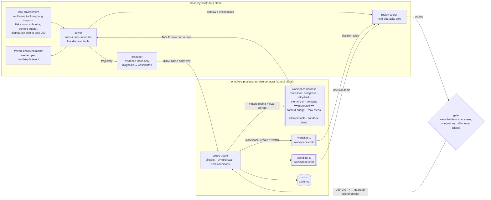

# aura-harness

**Harness self-evolution on Aura.** In this framing, Agent = Model + Harness. The model's weights stay frozen, and the agent improves the harness around it from execution feedback. Here the harness is five Aura workspace defines: tool routing, context compression/truncation, retry/error policy, memory promotion and sub-agent orchestration. Four more defines form a protected runtime boundary: context budget, step limit, tool allowlist and sandbox level.

The self-evolution loop works like this:
1. A **solver** runs tasks under the live harness and records trajectories.
2. A **proposer** reads the failed trajectories of *evidence* tasks, plus the current harness, and proposes one-component mutations.
3. A **scope guard** rejects any proposal that touches the protected boundary and logs the attempt.
4. Each remaining candidate is trialled in its own **forked worldline** (a `workspace :create` child; the live harness is never touched). The gate replays the recent window and scores **only held-out tasks** that the proposer never saw.
5. The best candidate is KEPT through `mutate:rebind` + `eval-current`, or everything is rolled back. Every step lands in an in-process **audit log**.

Everything is offline and reproducible from seeds. No LLM key is needed. There are interfaces for an LLM proposer (and the solver's model), but no number below uses them.

> Status: research MVP. The task environment and the "model" are simulated and seeded. The proposer works in a closed grammar (one component, table-level edits). Aura is pinned at `a6c63aa19` (re-pinned 2026-10-22 from `e50951bff`; first published on `c8ad457c9`). Read the caveats before quoting numbers.

## Why Aura for harness self-evolution

| | typical harness (edit files / plugins, then reload) | aura-harness |
|---|---|---|
| what gets mutated | source / config / prompt files, plugin modules | one workspace define (`route-tool`, `compress`, …): structured, queryable (`current-source :workspace`, `query :find`) |
| how a change takes effect | write the file, restart or reload the process (state is lost unless persisted) | `mutate:rebind` + `eval-current` in the running process; host state survives |
| trying a change safely | copy the tree, start a throwaway process | `workspace :create` child per candidate (or `ast:snapshot` → mutate → `ast:restore`); the live root is untouched |
| rollback | git / file copies | the root never changed; `ast:restore` in snapshot mode |
| scope control | convention, file permissions | guard outside the workspace: allowlist + symbol scan + post-conditions on the materialised decision table |
| audit | git log, ad-hoc logs | every trial / keep / rollback / blocked attempt in one log, with body, actor, scores and harness version |
| **measured cost of one guarded change (this repo)** | **29.5 ms** (edit + restart a minimal Python decision process) | **8.4 ms** round trip, guard included (69 ms on `c8ad457c9`, before aura#4585 was fixed; details below) |

Honest framing: the qualitative column is where Aura is clearly ahead. On the first pin the quantitative row was behind (the interpreted guard ran ~9× slower after `set-code`, aura#4585). With that fixed, a guarded Aura change is ~3.5× cheaper than restarting even this ~20 ms toy process. A real agent harness restart (model client, tool registry, conversation state) costs more.

## Architecture



* **Data plane in the host, control plane in Aura.** The environment, the model and the replays are Python. The harness code, its versions, worldlines, guard and audit log live in the Aura process. The host fetches a **materialised decision table** (every harness define evaluated over its finite input domain) once per harness version, so a task step costs no round trip. A harness with free-form inputs would call per decision; see the per-decision latency below.
* **Proposer in the host.** The proposer is Python and shared by the Aura and file-edit backends, so the comparison isolates the substrate. It reads the harness back through `TABLE` and `SOURCE`, edits one component, and compiles it to a flat-`cond` Lisp body (Aura) or a Python function (file-edit). aura-memory put its learner inside Aura; here it lives in the host so both backends share the exact same proposer.
* **Backends make identical decisions.** A test checks the verdict sequences match. Aura and file-edit KEEP the same mutations and score the same success; they differ only in latency and mechanism.

## Harness components and the scope guard

`aura/harness_seed.aura` is the seed harness. It is a plausible generic default:

| define | seed | what the proposer can change |
|---|---|---|
| `route-tool need` | search→grep, read→cat, edit→sed, test→pytest, query-db→sql, logs→journal | any tool in `allowed-tools` that offers the capability |
| `compress kind` | `("head" 800)` for every output kind | strategy `none/head/tail/head-tail/grep-errors/summarize` × limit |
| `retry-limit tool err` | 1 | 0–5 per (tool, error kind) |
| `memory-ttl fact` | 0 (never carry project facts) | tasks a learned fact is carried |
| `delegate kind nsub` | inline | delegate subtasks to fresh sub-agent contexts from n subtasks up |
| `context-budget`, `max-steps`, `allowed-tools`, `sandbox-level` | 4000, 30, 10 tools, `"restricted"` | **nothing: protected** |

The guard is host code in `server.aura`, outside the workspace, so no proposal can rebind it. It runs on every APPLY, TRIAL and VERDICT:

1. **Name check.** The name must be one of the 5 mutable defines. Protected or unknown names (including `static-check`, the guard itself) are rejected.
2. **Body check.** The body must be a `(lambda (...) ...)` that uses no protected name and no reflective or mutating primitive (`mutate:*`, `ast:*`, `workspace*`, `set-code`, `eval-current`, `eval`, `set!`, `define`, `current-source`, `query`, `getenv`, file/net/process, …) at a token boundary.
3. **Admission and fuel** (`AURA_HARNESS_FUEL`, default 100000 steps; 0 turns this stage off). The body is parsed by a small reader in `server.aura` and walked with scopes. Every free symbol must be on an allowlist of pure primitives plus the domain constants. Std-lib functions (`iota`, `assoc`, `make-list`, `string-join`, …) are excluded, because they are tree-walked Aura code that corrupts workspace locals (aura#4617), and so are clocks, `try`/`raise`/`call/cc` and anything starting with `%`. Then the body is instrumented. Each lambda, named-let and `do` body starts with a `(%tick)`, `while` is rewritten to a ticking named let (aura#4619), and `make-vector`, `string-append` and `append` calls are charged by result size. Fuel is refilled at every host entry, and a body that runs out fails with "fuel exhausted".
4. **Post-conditions.** After rebind + `eval-current` (in the trial worldline), the whole decision table must materialise. Every value must be in range, every route must be in `allowed-tools`, and the four protected values must equal the ones captured at startup. Otherwise the change is undone.

The proposer is deliberately naive about scope. On a context overflow, its first candidate is "raise `context-budget` to 8000", and on a step-limit failure it is "raise `max-steps`". Those are exactly the changes that would help a struggling agent, and exactly what must not happen.

## Primitive mapping

| harness self-evolution step | Aura primitive(s) | where |
|---|---|---|
| load the seed harness | `set-code` + `eval-current`, `ast:snapshot "seed"`; capture protected values | end of `server.aura` |
| make a decision | call a workspace define (`(route-tool "search")`, …) | `D`, `materialize` |
| read the harness | `current-source :workspace`, `(query :find name)` | `SOURCE`, `FIND` |
| propose → trial one candidate | `workspace :create`, `workspace :switch w`, `mutate:rebind name body why`, `eval-current`, materialise + post-check, `workspace :switch 0`, `workspace :delete` | `trial-ws` |
| … same, snapshot mode | `ast:snapshot`, `mutate:rebind`, `eval-current`, `ast:restore` + `eval-current` | `trial-snap` |
| KEEP | guarded `mutate:rebind` + `eval-current` on the root (snapshot first; `ast:restore` if a post-condition fails), version++ | `guarded-root-apply!`, `VERDICT` |
| ROLLBACK | nothing to undo: the root was never touched | `VERDICT -1` |
| scope guard | name allowlist, native `string-index` symbol scan, post-conditions | `static-check`, `post-check` |
| audit | append-only log `(seq ts op name why actor reason version body)` | `log!`, `LOG` |

`agent:spawn` is unbound in file mode on the pinned binary. Worldlines are therefore `workspace :create` children in one process, evaluated one after another. In ws mode a passing child is kept until the verdict, and KEEP promotes it with **`workspace :merge`** (child defines override the root's), then re-runs the post-check on the root under a snapshot. On `c8ad457c9` merge silently kept the parent's definition (**aura#4589**, filed from here, now fixed), so the winner used to be re-applied through the guard instead. Snapshot mode still re-applies.

## The task environment and the frozen model

`aura_harness/env.py` simulates terminal and tool-use tasks. Every draw is keyed by (seed, task, step, attempt), so base and candidate harnesses meet the same tools and the same model on replay (paired comparison).

* **Task kinds.** bugfix (search, read, edit, test), feature, data (query-db ×2, read), triage (logs, search, read), and refactor (2–6 subtasks of search/read/edit, then test). Each task first needs a project fact (test command, repo layout, DB schema). It either reads a config or uses a fact carried in memory.
* **Tools.** Each tool has an output kind, a length distribution, a position for the key line, and error kinds. Transient errors are timeout and rate-limit; non-transient ones are bad-args and not-found.
  - The test log's failure summary sits at the end.
  - Service logs are 1.5–7k tokens with the error somewhere in the middle.
  - `sed` fails with bad-args 30% of the time, and a retry repeats the same mistake 85% of the time.
* **Frozen model.**
  - A step fails with p=0.85 if compression dropped the key line ("info-lost").
  - It degrades above 80% context fill.
  - Above the budget the harness hard-truncates, and the step fails with p=0.5 ("context-overflow").
  - A stale carried fact fails the task with p=0.6.
  - Delegated subtasks get fresh contexts but cost handoff tokens and lose the handoff 4% of the time.
  - Tokens per task = the prompt tokens of every model call, plus outputs and side calls (summaries, handoffs).
* **Distribution shift at task 200.**
  - The task mix moves to triage and refactor (long logs, many subtasks).
  - `grep` starts timing out 45% of the time.
  - `lsp-find` becomes installed; before the shift it always returns not-found.
  - `sql` gets rate-limited 35% of the time.
  - Test logs grow 1.5×.
  - Every project's test command changes, so carried facts go stale.
* **Held-out split.** A fixed hash puts about half of all tasks in a held-out set. The proposer never sees their trajectories. The gate scores candidates only on them, replaying the last 80 tasks from a memory checkpoint. It does not judge until the window holds ≥20 held-out tasks.

## Results

The benchmark uses 5 seeds (0–4), 400 tasks per stream, and a shift at task 200 (`results/bench.md`). Success, verdicts and kept mutations are identical to the first run on `c8ad457c9`; only latency changed. Windows are 100 tasks each: windows 1–2 are before the shift, 3–4 after.

| mode | success (mean, min–max) | window 1 / 2 / 3 / 4 | held-out tasks | tokens / task | proposals | KEEP / ROLLBACK | blocked scope attempts |
|---|---|---|---|---|---|---|---|
| frozen harness | 24.1% (22.5–25.2) | 30 / 34 / 16 / 18 | 26.2% | 7,924 | – | – | – |
| file-edit + reload (gated) | 63.4% (59.0–68.2) | 53 / 76 / 56 / 68 | 64.0% | 8,377 | 19.8 | 12.0 / 7.8 | 1.0 |
| **Aura, gated** | **63.4%** (59.0–68.2) | 53 / 76 / 56 / 68 | 64.0% | 8,377 | 19.8 | 12.0 / 7.8 | 1.0 |
| Aura, no gate | 55.5% (52.0–58.8) | 51 / 74 / 40 / 56 | 57.1% | 9,176 | 27.4 | 27.4 / 0.0 | 1.0 |

Failure modes, as a share of all tasks:

| mode | info-lost | tool-error | context-overflow | stale-memory | handoff-loss | model-error |
|---|---|---|---|---|---|---|
| frozen | 41.4% | 26.4% | 2.5% | 0.0% | 0.0% | 5.7% |
| Aura, gated (= file-edit) | 11.6% | 11.4% | 3.7% | 2.8% | 0.6% | 6.6% |
| Aura, no gate | 16.2% | 10.9% | 6.3% | 2.5% | 0.8% | 7.8% |

Findings:

* **The loop rediscovers sensible harness engineering.** On all 5 seeds it learned to route edits to `apply-patch` instead of `sed`, compress service logs with `grep-errors`, and carry `test-cmd` and `repo-layout` for 40 tasks. On 4 of 5 seeds it also learned to keep the tail of test logs and to retry `sql` rate-limits 3 times. On all 5 it kept some delegation threshold for refactors (≥2 on 3 seeds, ≥4 or ≥6 on the others). [`results/example-aura-gated-seed0/`](results/example-aura-gated-seed0) has every verdict with base vs candidate held-out scores, the full audit log (77 entries) and the final harness source.
* **Recovery after the shift is partial.** Success dips from 76% to 56% and recovers to 68%. One reason is visible in the log: the gate window straddles the shift. Right after task 200, `route search->lsp-find` (the best post-shift tool) is replayed on pre-shift tasks where it isn't installed, and it loses (16/42 held-out vs 31/42 for `rg-json`). The loop then settles on `rg-json`, or on more grep retries.
* **The gate matters.**
  - With clean diagnoses, the ungated loop keeps every first candidate. It oscillates (for example `compress service-log tail/1600` ↔ `head-tail/1600`, 35 keeps across seeds), spends more tokens (9.2k vs 8.4k per task) and scores 7.9 points lower.
  - With 30% of diagnoses mis-attributed: gated 62.9%, ungated 52.6% (`results/noise30.md`).
  - With **every** diagnosis mis-attributed (`results/noise100.md`): gated 37.8%, ungated 29.5%, frozen 24.1%. The gate rolled back 20 of 28 proposals per stream and kept only the random edits that helped on held-out tasks. It won on 4 of 5 seeds; on seed 2 it lost (27.3% vs 29.5%).
* **Tokens go up where they buy success.** The adaptive harness spends more per task after the shift (9.8k vs 7.4k frozen), mostly on longer compression limits and delegation overhead. The KEEP rule only prefers cheaper when success is tied.
* **Scope guard.** The naive budget raise was proposed and blocked once per stream (it is then remembered and never re-proposed). The context budget stayed at 4000 on every stream. Step-limit failures never occurred, so `max-steps` was never targeted in the bench; the attack suite covers it.

### Worldlines

* **Workspace children vs snapshot/restore** give identical verdicts and success on all 5 seeds (`results/snap.md`). Per-candidate trial cost is also about the same: 7.9 ms (child workspace) vs 8.2 ms (snapshot) in-process.
* **Parallel replays.** Candidate replays in a 4-process pool give the same verdicts, and now help a little: gate p50 36 ms vs 54 ms sequential (on `c8ad457c9` the pool was slower, 215 vs 191 ms; `results/parallel.txt`). Worldlines are created one after another inside one Aura process; `agent:spawn` is not available in file mode.

### Long runs: one process, thousands of changes (`scripts/longrun.py`)

The bench streams make about 20 proposals each. A real harness that keeps evolving makes thousands, all in one Aura process. `scripts/longrun.py` drives random valid edits of the 5 mutable components through the real protocol. Each step is a guarded APPLY, or a 2-candidate TRIAL followed by a KEEP or ROLLBACK VERDICT. Every 200 steps it records p50 latency (host-measured) and the control-plane RSS. `results/longrun/` has the raw rows.

ws worldlines, 2000 steps (mix: apply / trial+keep / trial+rollback in turn). The last column is the same run with the root reloaded from its own source every 100 root mutations (`AURA_HARNESS_COMPACT_EVERY=100`):

| step | APPLY p50 ms | TRIAL p50 ms | DECIDE p50 ms | RSS MB | with compaction: APPLY / TRIAL / RSS |
|---|---|---|---|---|---|
| 200 | 11.47 | 26.58 | 0.34 | 204 | 11.91 / 28.3 / 205 |
| 600 | 27.87 | 72.88 | 0.44 | 613 | 26.43 / 69.73 / 584 |
| 1000 | 41.98 | 108.34 | 0.44 | 1,125 | 42.21 / 102.66 / 1,129 |
| 1400 | 58.4 | 158.7 | 0.48 | 1,546 | 61.36 / 161.34 / 1,539 |
| 2000 | 97.0 | 264.97 | 0.45 | 2,279 | 96.08 / 269.08 / 2,295 |

One operation repeated 600 times (RSS at step 200 / 400 / 600; TRIAL p50 at step 200 → 600):

| repeated operation | ws worldlines | snapshot worldlines |
|---|---|---|
| guarded APPLY on the root | 177 / 304 / 438 MB, APPLY 12 → 23 ms | – |
| TRIAL (2 candidates) + ROLLBACK | 147 / 207 / 265 MB, 21 → 41 ms | 147 / 205 / 266 MB, 22 → 44 ms |
| TRIAL (2 candidates) + KEEP | 297 / 645 / 989 MB, 33 → 85 ms | 474 / 1,405 / 2,727 MB, 40 → 192 ms |

**Every operation that rebinds anything gets slower with the process's mutation history, and memory never comes back.** At step 2000 a guarded change costs 10× what it did at step 100 (97 vs 10 ms), and the process holds 2.3 GB for a ~3 KB harness. Micro-repros isolated two Aura causes, both filed or reopened from here:
- **aura#4583 (reopened):** every `mutate:rebind` pays for all earlier rebinds of that workspace. 4000 rebinds of the same 2-clause body go from ~1 ms to 7 ms each and reach ~1 GB. `ast:restore` doesn't release it, which is why snapshot worldlines are the worse mode in a long run. Reloading the workspace from its own source resets the time (not the memory) in a fresh process.
- **aura#4610 (new):** a trial in a child workspace (create → switch → rebind → eval → switch back → delete) keeps ~140 KB after the child is deleted. Every later rebind, in the root too, gets slower. This is what ws worldlines pay, and it is why the compaction knob doesn't help here (compare the last column).

The harness's own state is small: the audit log has 4,668 entries after 2000 steps, and DECIDE stays at ~0.4 ms throughout. Until these are fixed, a long-lived aura-harness process should be restarted periodically, carrying the current source and the audit log over. The compaction knob (`AURA_HARNESS_COMPACT_EVERY`, `COMPACT` command, off by default) stays for re-measuring once they are.

### Harness size: hundreds of mutable defines (`scripts/size_sweep.py`)

The seed harness has 9 defines. Real harnesses grow. `AURA_HARNESS_KNOBS=N` appends N extra **mutable** defines `knob-i` (a tool-parameter table over x ∈ {0..3}, values range-checked to [0,100] by the same post-check) plus `knobs-all`, which reads them for the materialised table. `knobs-all` isn't mutable. The knobs don't change the task environment; they make every rebind, snapshot, restore and post-check run over a bigger workspace. `scripts/size_sweep.py` starts one control plane per N and times 20 rounds of each protocol operation over the real pipe (p50 ms, main e50951bff; raw rows in `results/size/`):

| N knobs | source chars | startup s | RSS MB | TABLE | APPLY (knob) | TRIAL ws (2) | TRIAL snap (2) | VERDICT |
|---:|---:|---:|---:|---:|---:|---:|---:|---:|
| 0 | 691 | 0.05 | 108 | 4.8 | 8.6 | 16.5 | 17.1 | 0.5 |
| 50 | 5,668 | 0.07 | 220 | 5.3 | 17.1 | 42.9 | 48.6 | 0.7 |
| 200 | 19,959 | 0.11 | 146 | 5.9 | 22.9 | 45.5 | 53.2 | 0.7 |
| 500 | 48,999 | 0.21 | 232 | 9.3 | 45.5 | 92.0 | 107.7 | 1.0 |
| 1000 | 97,359 | 0.42 | 520 | 16.4 | 87.3 | 187.5 | 211.1 | 1.4 |

With `knobs-all` as **one flat define calling all N knobs** (`--chunk 0`), the same sweep is superlinear: knob APPLY 163 ms at N=500 and **534 ms at N=1000**, TRIAL ws 1,078 ms, startup 1.26 s. A `retry-limit` APPLY in the same process costs 88 ms. gdb put 33 of 40 samples in Aura's IR dirty cascade (`IRCacheEntry::mark_body_only_dirty → cascade_block_to_instructions`). Rebinding `f` re-marks every basic block of each define that calls `f`, and each block mark recomputes prefix sums over all blocks, so it is O(B²) in the caller's size. A standalone repro costs 5 / 20 / 69 / 252 ms per rebind for callers with 500 / 1000 / 2000 / 4000 call sites. Filed as **aura#4615**. The harness now reads the knobs through `knobs-chunk-j` callers of 16 knobs each (`AURA_HARNESS_KNOB_CHUNK`, default 16), which makes a knob APPLY cost the same as any other APPLY (88 ms at N=1000). What remains is linear in workspace size. That's aura#4598: every rebind+eval, snapshot and restore walks the whole workspace (BENCH at N=1000: rebind+eval 10 ms, snapshot 4 ms, restore+eval 26 ms, materialize 15 ms). DECIDE stays at ~0.3 ms at every size.

### Latency: Aura in-process vs file-edit + reload

All numbers are from `results/latency.json` (p50, measured inside `ghcr.io/cybrid-systems/dev:v1.0.9` with `--memory=4g`).

In-process inside the Aura control plane (`BENCH`; Aura only has a ms clock, so steps are looped and averaged). The last column is the first run on `c8ad457c9`:

| step | after `set-code` (real setup) | harness pasted as plain program defines (former aura#4585 ablation) | after `set-code` on `c8ad457c9` |
|---|---|---|---|
| one harness decision (workspace define call) | 4 µs | 5 µs | 98 µs |
| materialise the full decision table (~95 calls) | 4.2 ms | 1.8 ms | 20.8 ms |
| static guard check (pure host code) | 0.59 ms | 0.61 ms | 17.8 ms |
| `mutate:rebind` + `eval-current` | 0.65 ms | (not comparable) | 3.0 ms |
| `ast:snapshot` | 0.15 ms | (not comparable) | 2.75 ms |
| `ast:restore` + `eval-current` | 0.4 ms | (not comparable) | 6.25 ms |
| guarded change (static + snapshot + rebind + eval + table + post-check) | 6.9 ms | 3.5 ms | 65.2 ms |
| trial in a child workspace / in a snapshot | 7.9 / 8.2 ms | 3.5 / 3.5 ms | 67.8 / 69.8 ms |
| blocked attempt on a protected name | 0.01 ms | 0.01 ms | 0.2 ms |

Host round trips (Python ↔ process over pipes):

| | Aura | file-edit + reload | Aura on `c8ad457c9` |
|---|---|---|---|
| one decision | 0.15 ms (0.13 ms as plain defines) | 0.017 ms (plain dict lookup in the decision process) | 1.43 ms |
| one guarded change | 8.4 ms | 29.5 ms (write `harness_live.py` + restart; restart alone 21.4 ms) | 69 ms |
| one trial, per candidate | 10.2 ms (child workspace) / 9.2 ms (snapshot) | 28.9 ms (copy dir + edit + start a throwaway process) | 71.6 / 74.1 ms |
| blocked attempt | 0.4 ms | not timed (a Python name check before any edit) | 2.8 ms |
| during the bench: change / whole gate / stream wall time | 7.2 ms / 64 ms / 1.4 s | 23.7 ms / 134 ms / 2.9 s | 56 ms / 246 ms / 5.6 s |

How to read this:
* **aura#4585 was the whole story.** Host code no longer slows down after `set-code`. Decisions, the static check and blocked attempts now cost the same as with the harness pasted in as plain defines. Materialisation and the guarded change are still about 2× the plain-define figure; that gap is the real workspace's rebind/eval, which the ablation doesn't have.
* **A guarded Aura change is now cheaper than the toy file reload** (8.4 ms vs 29.5 ms round trip; 7.2 vs 23.7 ms during the bench), and a whole gate costs about half as much (64 vs 134 ms).
* **The file-edit baseline is the most favourable case for file edits.** It restarts a 40-line decision server, not an agent. It also exposed a real hazard of file-reload harnesses. The first version imported the edited module, and Python's `__pycache__` served **stale bytecode** whenever an edit kept the file size within the same second (`"summarize"` → `"head-tail"`). The backend-equivalence check caught the resulting divergence; the server now `exec`s the source.
* **Per-decision latency through the pipe is still Aura's weak spot** (0.15 ms vs 0.02 ms), almost all of it pipe + JSON. That is why the host fetches a materialised table once per harness version instead of calling per step.

Numbers above are with the fuel stage off. Its cost is below, under Runaway proposals.

### Runaway proposals (`scripts/runaway.py`)

A proposed body is arbitrary Lisp that runs inside the control plane. Aura has no step budget or preemption: `fiber:*` is cooperative, and `orch:parallel`'s timeout still joins every fiber. Before this round, the static guard only looked at tokens, so one non-terminating body hung the control plane and one allocating body got it OOM-killed. `scripts/runaway.py` runs 24 bodies × 3 entry points (APPLY, TRIAL ws, TRIAL snap): 16 runaways or forbidden constructs and 8 legitimate bodies. Each run is a fresh control plane in its own process group, with a 20 s wall limit (`--timeout 20`) and a 4 GB container. The table shows the worst of the three entry points (`results/runaway/fuel-{on,off}.json`, `scripts/runaway_table.py`):

| body | expect | before (token guard only) | after (fuel 100000) |
|---|---|---|---|
| `loop` | reject | hang (>20 s) | fuel exhausted (610 ms) |
| `rec` | reject | **killed** (OOM, 4.5 s) | fuel exhausted (736 ms) |
| `mutual` | reject | hang (>20 s) | fuel exhausted (608 ms) |
| `omega` | reject | hang (>20 s) | fuel exhausted (613 ms) |
| `do` | reject | hang (>20 s) | fuel exhausted (692 ms) |
| `while` | reject | hang (>20 s) | fuel exhausted (526 ms) |
| `cons-bomb` | reject | hang (>20 s) | fuel exhausted (818 ms) |
| `str-double` | reject | **killed** (OOM, 7.6 s) | fuel exhausted (13 ms) |
| `str-alias` | reject | **killed** (OOM, 4.2 s) | rejected: allocator used as a value (call it directly): string-append (6 ms) |
| `append-many` | pass | applied (12 ms) | applied (16 ms) |
| `strapp-3` | pass | applied (12 ms) | applied (15 ms) |
| `vec-huge` | reject | **killed** (OOM, 2.0 s) | fuel exhausted (12 ms) |
| `iota-huge` | reject | hang (>20 s) | rejected: symbol not allowed: iota (5 ms) |
| `slow-3M` | reject | applied (5368 ms) | fuel exhausted (568 ms) |
| `mech-cycle` | reject | hang (>20 s) | fuel exhausted (471 ms) |
| `catch-fuel` | reject | rejected: token: try (3 ms) | rejected: token: try (3 ms) |
| `shadow-tick` | reject | rejected: token: % (3 ms) | rejected: token: % (3 ms) |
| `clock` | reject | applied (13 ms) | rejected: symbol not allowed: current-time-ms (5 ms) |
| `comment` | reject | rejected: token: set-code (4 ms) | rejected: token: set-code (3 ms) |
| `busy-50k` | pass | applied (152 ms) | applied (1598 ms) |
| `vec-20k` | pass | applied (12 ms) | applied (17 ms) |
| `stdlib-fn` | reject | applied (12 ms) | rejected: symbol not allowed: assoc (8 ms) |
| `case-table` | pass | applied (11 ms) | applied (18 ms) |
| `helpers` | pass | applied (16 ms) | applied (20 ms) |

**Before: 27 of 72 runs correct, 24 hangs, 12 OOM kills, 9 runaways applied.** `slow-3M` (5.4 s per decision) and `stdlib-fn` were applied as if harmless. **After: 72 of 72 correct.** Every runaway is rejected within 0.82 s, and the control plane stays alive and keeps serving. Legitimate bodies still apply, with harness source and audit log unchanged. `SOURCE` (what a proposer reads) strips the instrumentation: across seeds 0–4 the final harness text is byte-identical to a fuel-off run.

Cost, from `results/runaway/latency-fuel-*.json` and `bench-fuel.md`:

| | fuel off | fuel 100000 |
|---|---|---|
| one decision (in-process) | 6 µs | 6 µs |
| admission (static check + parse + walk + instrument), 100-char body | 1.0 ms | 3.5 ms |
| guarded change, in-process / round trip | 9.0 / 10.1 ms | 13.1 / 17.5 ms |
| trial per candidate (ws / snap), in-process | 8.9 / 9.5 ms | 15.5 / 16.2 ms |
| bench, seeds 0–4: change / gate / trial call p50 | 8.5 / 67 / 26 ms | 10.2 / 81 / 38 ms |
| bench outcome (success, verdicts, kept mutations) | 63.4% | identical, per seed |
| tight loop in a body, 50k iterations | 152 ms | 1.6 s |

Two findings from tuning this:
* **A tick costs ~5 µs,** made up of host-vector ops plus a workspace call. The cheap version, an inline `set!` counter, doesn't work in a workspace define: the `set!` of a global is dropped, and a comparison after a captured-cell `set!` is constant-folded (aura#4618). Calling a host function from the tick instead let the tree-walker reclaim objects the IR frame still held (aura#4617). So table-shaped bodies pay one tick per decision, and loop-heavy bodies are ~10× slower.
* **The first tokenizer cost 9.4 ms per admission.** File-level Aura loops cost ~3–4 µs per iteration, and the std-lib `string-split`/`string-join` are such loops (~4 µs per character); the pad/split/join tokenizer made 9 passes. The fix is one pass over `string->list` with `substring` slices, plus a single native `apply string-append` in the emitter. A differential test over 61 bodies gave identical results; the only difference is a more precise reason for an escaped quote. Admission dropped to 3.5 ms.

Other Aura issues found on the way, all filed with repros: an error in a `while`/`when`/`unless` body is discarded, and an error in the `while` test loops forever (aura#4619); the IR call stack is unbounded, so deep recursion in a workspace define is OOM-killed instead of raising (aura#4620); rest parameters don't work in workspace defines (aura#4621); `#\(` / `#\)` / `#\"` literals confuse the file runner's top-level form splitter: a file whose first form has one is refused, and later ones print a spurious warning (aura#4622). A guard-side workaround applies to each: the `while` rewrite, the 100000-step budget (well below the ~5M frames that 4 GB allows), list-argument wrappers, and char codes in `server.aura`.

### Differential proposal fuzzer (`scripts/fuzz_proposals.py`)

The fuzzer generates random knob bodies over the guard's allowlisted subset (`let`/`let*`/`letrec`, named-let loops, `cond`/`case`, closures, list/vector ops, `map`/`filter`), always `(lambda (x) (modulo (abs E) 101))`. It runs each body down four paths and compares the 4 knob values with a Python reference evaluator:
- `apply`: guarded change in the live harness;
- `trial`: child-workspace trial;
- `nofuel`: apply with `AURA_HARNESS_FUEL=0`, so bodies run uninstrumented with native functions;
- `file`: the body in a plain file, no workspace.

300 bodies per seed, on the pin e50951bff:

| | apply | trial | nofuel | file |
|---|---|---|---|---|
| R7 first run (seed 1, native `map`/`filter`/`last`) | 17 wrong | 18 wrong | 67 wrong | 0 |
| + workspace HOFs and std-lib wrap, seed 1 | **0** | **0** | 63 | 0 |
| same, seed 2 | **0** | **0** | 69 | 0 |
| same, seed 3 | **0** | **0** | 77 (1 hang) | 0 |
| seed 1 on main 9f82bede1 (before the wraps) | 220 wrong (182 "body is not a lambda", 3 crashes) | 236 | 106 | 6 |

Every wrong value traced to an Aura bug, not to the guard:
- **aura#4626:** two callbacks handed to native `map`/`filter`/`for-each` from sibling expressions of one workspace define get an invalid closure, and `map`/`filter` swallow the error into `()`. Proposed `map`/`filter`/`for-each` now run as workspace named-let loops (`%map`/`%filter`/`%for-each`, `AURA_HARNESS_HOF_WRAP`, default 1). n-ary `map` is rejected (aura#4616).
- **aura#4617 via std-lib functions:** `last`, `list-tail`, `assq`, `even?`, `odd?`, `zero?`, `positive?`, `negative?` and `expt` are file-level Aura defines. A knob calling one made the knob-chunk caller read wrong lists on every 5th read, like `(((0) 0 6 5) ((1) 0 6 5) (1))` for a 4-knob row. Each is now renamed at admission to a workspace `%` version (`AURA_HARNESS_STD_WRAP`, default 1). `string-split`, `string-upcase`, `string-downcase` and `symbol->string` are off the allowlist. SOURCE shows the plain names in both cases.
- **nofuel** keeps its mismatches by design: with fuel off, nothing is instrumented or renamed. The column documents what the wraps buy. Seed 3 body 175 (native `filter` + `last`, a `letrec` recursion) hung the uninstrumented control plane after 174 earlier rebinds in the same process. A fresh process returns a wrong value instead (74 → 4, the #4617 `last` corruption), and the fuel paths get it right. The fuzzer now has a per-body watchdog (`--call-timeout`, default 60 s) that kills, records `timeout` and restarts.
- **main 9f82bede1 / 39595edd4:** two new c6a18e8a5 regressions. The guard's recursive-descent reader returns cyclic or empty lists on the second read (an 8-line repro, posted on aura#4623). `equal?` is `#f` on every 66th iteration of a tail-call loop when its first argument is freshly allocated (**aura#4627**, 3 lines).

The wraps cost time: on seed 1, `apply` went from 49.5 to 57.7 s for 300 bodies (+16%), because a wrapped call is a ticked workspace loop instead of a native one.

**Round 9: strings, vector loops and an automatic shrinker.**
- **`--gen 2`** adds strings to the grammar:
  - built by `string-append` (metered), prefix `substring`, `string->list`/`reverse`/`list->string`, and named-let accumulation;
  - read back with `string-length`, a `string->number` digit, and `string=?`/`string<?`/`string>?`.
  
  It also adds vectors filled by `vector-set!` in a named let (`make-vector` metered), `vector->list`/`list->vector` round trips, and `equal?` on lists. `--gen 1` (the default) still produces byte-identical R7 bodies.
- **`--shrink N`** reduces up to N mismatching bodies per path. It replaces subterms greedily, root first, with a constant, a same-kind child, or the list minus one element. Each step re-derives the expected value with the reference evaluator, and the step is kept only if the path is still wrong in the same way. For the `file` path, a body that only fails after earlier defines in the same batch is re-run behind them, and that context is cut down by halves while the failure persists. A body that doesn't fail on its own is reported as `does not reproduce in isolation`.

| `--gen 2`, 300 bodies | apply | trial | nofuel | file |
|---|---|---|---|---|
| pin `e50951bff`, seed 1 | **0** | **0** | 38 | 0 |
| pin, seed 2 | **0** | **0** | 51 | 0 |

`file` path, 300 bodies per run, `--gen 1` seeds 1–3 plus `--gen 2` seeds 1–3: the pin `e50951bff` has **0/1800** wrong, main `39595edd4` has **42/1800** (`results/fuzz/main39595-file-*.json`).

- **Strings and vector loops are clean through the guard on the pin.** apply/trial have 0 wrong over 600 v2 bodies. apply costs 61–68 s per 300 bodies (v1: 57.7 s).
- **The shrinker turns nofuel mismatches into ~70-char repros in 50–200 runs.** `(lambda (x) (let ((l1 (map (lambda (y7) 0) (list 1)))) (last l1)))` is the #4617 family. `(lambda (x) (length (filter (lambda (y11) (= 0 0)) (list 1))))` (1650 → 62 chars) gives `[0, 0, 0, 1]` instead of `[1, 1, 1, 1]`. That case widened **aura#4626**: one inline callback is enough when another workspace define calls its define several times. The knob table's `(list (knob-0 0) … (knob-0 3))` is exactly that, so only the last call is right; with sequential `let*` calls only the first is right. The `%map`/`%filter` wraps already cover it. `acceptance/4626-sibcall`.
- **Main's file-path failures are #4629 heap corruption.** Most only fail inside the 300-define batch. Any context cut makes them pass, so the trigger is allocation shape rather than a particular earlier define. One fails alone from its 4th hot call. The shrinker plus a hand pass gave a 2-line repro: a fresh `(vector x 0 0)` in a `map` callback reads back with length 0 in a 10-call loop, on `c6a18e8a5`, `9f82bede1` and `39595edd4`, and is correct on the pin. Posted on **aura#4629**; `acceptance/4629-vec`.

**Round 11: knobs that call knobs (`--multi M`).** One live harness takes a sequence of 300 random changes over `knob-0`…`knob-(M-1)`. A body for `knob-j` may call `(knob-i E)` for any `i < j`, so a rebind of a low knob changes every knob above it. After each change the fuzzer compares the whole M×4 decision table with the reference and records APPLY latency, the harness process's RSS and (with `--table-ms`) the TABLE read latency. The file path re-`define`s the knobs in the same order in one batch file.

| pin `e50951bff`, 300 changes, `--paths apply,file` | apply correct | apply time | file |
|---|---|---|---|
| M=4, seeds 1/2/3 | **300/300** each | 219 / 162 / 193 s | 300/300 |
| M=8, seed 1 | **300/300** | 590 s | 300/300 |
| M=8, seed 2 (before fuel blocks were skipped) | 76, then a legitimate fuel block | 215 s | 300/300 |
| M=8, seed 3 | 130, then OOM-killed (4 GB) | 191 s; APPLY deciles up to 3.1 s, steps up to 10 s, TABLE 5–64 ms | 300/300 |
| + path-weight guard | the same (max weight 242 < 1024) | 190 s | 300/300 |
| + `knob-row4` | **293**, then OOM-killed at 3.0 GB | 443 s for 2.25× the steps; APPLY deciles 0.1–2.1 s | 300/300 |
| M=4, seed 1 + `knob-row4` | **300/300** | **106 s** (was 219 s); RSS 1.9 GB at the end | 300/300 |

- **No wrong value in any multi-knob run.** Every step that was applied gave the right 4×M table (about 2,000 checked rebinds). Cross-knob calls go through the guard's `%` wraps and fuel like everything else.
- **The cost is aura#4630 (filed from here).** Workspace `set-code`, `eval-current` and `mutate:rebind` compile in time exponential in call-chain depth when each define calls the one below it at 2 sites: 20 / 78 / 385 / 1,844 ms at depths 8 / 10 / 12 / 14. A rebind of the top define, which nothing calls, pays it too. File level is flat at ~54 ms. Call sites count; value references don't. TABLE reads stay at 5–64 ms, so the time goes to compiling, not running. `acceptance/4630` FAILs on the pin (80 → 264 ms from depth 10 to 12) and on `39595edd4` (84 → 315 ms).
- **The harness's own chunk caller was the multiplier.** The 16-knob chunk caller (the #4615 workaround) calls each knob at 4 sites, one per input, so every knob-to-knob call added a factor of 4 rather than 2. A trivial rebind standalone cost 54 ms without the chunk, 824 ms with it, and **232 ms** with `knob-row4`: the chunk passes each knob as a value to `(knob-row4 f)`, which calls `f` on 0..3, and value references cost nothing in #4630. `AURA_HARNESS_KNOB_ROW4` defaults to 1, and TABLE output is byte-identical.
- **Path-weight guard.** At admission, `path-check` counts the call sites from the new body to each workspace define it calls, using the current source and native `string-index`, and multiplies along every path. A body whose heaviest path is over `AURA_HARNESS_PATH_MAX` (default 1024) is blocked with "call-path weight N … exceeds AURA_HARNESS_PATH_MAX (aura#4630)". It never fired in the fuzz runs, because the random bodies reach weights ≤ 242. It is there to stop a deliberately deep proposal from stalling the control plane. Unit tests: a weight-41 body is accepted, a weight-1641 body is blocked, and a weight-83 body gives the right table.
- **What remains is memory.** RSS grows 6–10 MB per rebind on the pin (101 MB → 3.0 GB over 293 steps). That is the rebind-history growth of aura#4583, fixed on main in a398f78a7 but not adopted here because of #4623, #4627 and #4629. The workaround is the existing one: restart the control plane periodically (`scripts/longrun.py`).

**Round 13: hash tables (`--gen 3`).** Adds a `(hash)` filled by `hash-set!` in a named let and read back four ways: `hash-ref` with a default, `(length (hash-keys h))`, `hash-remove!` then the count, and `hash-has-key?`. Keys are small ints, 1-element lists (`equal?` keys), or a prefix of `"abc"`, which can be `""`. `--no-empty-key` never uses `""`. `hash-keys`, `hash-remove!` and `hash-length` are now on the guard's allowlist; all are native primitives.

| `--gen 3`, 300 bodies, pin `e50951bff` | apply | trial | nofuel | file |
|---|---|---|---|---|
| seed 1, before the wrap | 30 wrong | 30 | 60 | 30 |
| seed 1, `--no-empty-key` | **0** | **0** | 33 | **0** |
| seed 1, with `AURA_HARNESS_HASH_WRAP` | **0** | **0** | – | – |
| seed 2, with the wrap | **0** | **0** | 54 | 27 |
| seed 3, with the wrap | **0** | **0** | 55 | 32 |

- **Every hash mismatch was `""`.** The shrinker cut each one to about 165 characters, for example `(let ((h (hash))) (let loop ((i 0)) (if (< i 6) (begin (hash-set! h (substring "abc" 0 0) x) …))) (length (hash-keys h)))`, which gives 0 instead of 1. `hash-set!` and the `hash` constructor silently drop the empty-string key. It is a guard from an old corruption fix, filed from aura-memory as **aura#4631**. With `""` excluded, all four paths agree with the reference on ints, strings and list keys. The nofuel column is the known #4617/#4626 family, as before.
- **The wrap.** `AURA_HARNESS_HASH_WRAP` (default 1) wraps the key, the second argument of `hash-set!`/`hash-ref`/`hash-has-key?`/`hash-remove!`, in `(%hk k)`. That stores a string key as `"s:" + k`. `(hash k v …)` becomes `(%hash0 (hash (%hk k) v …))`, and `hash-keys` becomes the decoding `%hash-keys`. A hash operation used as a value is rejected. SOURCE strips all of this, so it shows the plain body. `%hash0` charges 8 fuel steps per table, because a `(hash)` is never reclaimed (aura#4613). apply time went 71 → 80 s per 300 bodies (+12%). Covered by `HashWrapTests`.
- **The request loop leaks; the hash body barely matters.** Repeated `TABLE` calls keep 13 KB each (2,000 → 8,000 calls: 101 → 206 MB), whatever the knob body is. A body that allocates a `(hash)` per call adds 2.3 KB per table (4 calls). Even `PING` keeps 1.3 KB. A bare stdin loop splits that into `(hash "pong" #t)` ~0.65 KB, `string-split` ~0.37 KB and `json-encode` ~0.19 KB per request: #4613 plus #4608 strings. Posted on **aura#4613**. The host already fetches the table once per policy version, and long runs restart the control plane.

### Scope guard

`python3 -m aura_harness guard` (`results/guard.txt`) runs 13 attempts against the live harness:
- 4 rebinds of protected defines;
- a `mutate:rebind` smuggled inside a mutable body;
- a `set!` of the budget;
- calls of `eval-current`, `current-source` and `workspace :switch` from a body;
- a rebind of the guard itself;
- routing to `net-raw`;
- `retry 99`;
- a compression limit above the budget.

All 13 are **BLOCKED** with a reason. The harness source is byte-identical afterwards, `context-budget` is still 4000, the audit log holds 13 `blocked` entries, and a legitimate change still applies. The unit test `test_proposer_cannot_raise_its_own_budget` drives the real proposer through three context-overflow failures. It checks that the proposer's first candidate is the budget raise, that the candidate is blocked in its trial and logged with actor `proposer`, and that it is never proposed again.

The guard is an allowlist, a step budget and post-conditions, not a sandbox. With fuel off, it falls back to the old token denylist, where a body that computes a symbol at runtime could get past step 2. With fuel on, `string->symbol`, `apply` and `eval` aren't on the allowlist. Still, a reader in Lisp is not a proof. Real enforcement belongs in Aura's capability sandbox, which this repo can't use yet. #4575 added a scoped Soft auto-grant (`aura soft`), but under it `mutate:rebind` is refused with `commit-not-ready` (**aura#4609**), so everything still runs with `AURA_SANDBOX=off` in a memory-capped container.

## Published harness self-evolution work, mapped to Aura primitives

Only papers whose arXiv pages I checked are listed.

**Meta-Harness: End-to-End Optimization of Model Harnesses.** Yoonho Lee, Roshen Nair, Qizheng Zhang, Kangwook Lee, Omar Khattab, Chelsea Finn. arXiv:2603.28052 (2026). <https://arxiv.org/abs/2603.28052>

An outer loop searches over harness code. An agentic proposer reads the source code, scores and execution traces of *all prior candidates* through a filesystem, and each proposed harness is evaluated and logged.

| Meta-Harness | Aura equivalent | in this repo |
|---|---|---|
| candidate harness = a code directory | one workspace define edit, held in its own `workspace :create` child | `trial-ws` |
| filesystem of prior candidates (source, scores, traces) | the in-process audit log (every candidate body, scores, verdict) + `current-source :workspace` / `query :find` | `LOG`, `SOURCE`, `FIND` |
| evaluate a candidate | materialise the child's decisions, replay held-out tasks | `TRIAL` + `replay_score` |
| search on validation data, keep the best | KEEP only on more held-out successes (or tie and fewer tokens) | `better()`, `VERDICT` |
| gap | Meta-Harness's proposer is a coding agent editing arbitrary code and keeping many candidates; ours edits one component in a closed grammar (free-form Lisp only through the optional LLM hook, still guarded) and keeps only the current harness + this round's candidates | – |

**Self-Evolving Harness on Multiple Tasks with the Agent as Its Own Optimizer.** Qiankai Xu (Nanjing University). arXiv:2609.38372 (2026). <https://arxiv.org/abs/2609.38372>

The same frozen model, on the same harness version, first solves tasks and then, as the proposer, edits the harness that runs it. A new version is accepted if it passes engineering checks (runs with a mock model, within an edit budget of new lines). The paper names two gaps:
- the loop has no per-update validation gate ("validating each update at an acceptable cost is a missing piece");
- evolution may benefit from keeping several versions or paths.

It also reports a regression in which the evolved harness exposed a run-configuration tool, and the agent used it to lower its own conversation step limit.

| that paper | Aura equivalent | in this repo |
|---|---|---|
| acceptance = runnability check | post-conditions: the full decision table must materialise with in-range values | `post-check` |
| missing per-update validation | held-out replay gate per candidate, ~60 ms per gate here | `gate`, `results/bench.md` (gated vs no gate, noise ablations) |
| keep several versions / paths | one `workspace :create` worldline per candidate; snapshot mode as a fallback | `TRIAL ws|snap` |
| edit budget (new lines) as learning rate | one component per mutation, closed grammar | `proposer.py` |
| evolution notes carried between rounds | structured audit log (not free text) | `LOG` |
| agent lowered its own step limit through a tool | `max-steps` / `context-budget` are protected defines; every attempt to change them is rejected and logged | `guard.py`, `test_proposer_cannot_raise_its_own_budget` |

## Swarm: Agensh-style self-organizing fibers (`aura/swarm.aura`)

N identical worker fibers, no orchestrator, each running Gather → Claim → Act → Verify → Merge over a typed append-only board, per-worker channel mailboxes and a versioned workspace; deterministic mock proposer with acceptance checks. `python3 -m aura_harness.swarm epoch N K F cap`, full sweep `scripts/swarm_bench.py` → `results/swarm-bench.md`. Design, findings and numbers: [docs/swarm-design.md](docs/swarm-design.md). Coordination scales (rounds 1991 → 16 for N 1 → 1024) but wall time doesn't: fibers are serialized, `fiber:yield` doesn't interleave and fibers get silently dropped (aura #4697–#4702).

## Observability

Opt-in per-run tracing for the RSI loop and for the swarm/supervisor modes (`aura_harness/obs.py`, design and span schema in [docs/observability.md](docs/observability.md)). Off by default; with no tracer the code path is unchanged.

```bash
python3 -m aura_harness trace rsi --seed 1 --n 400 --otlp runs/rsi.otlp.json
python3 -m aura_harness trace swarm --N 4 --K 256 --F 32
python3 -m aura_harness trace supervisor --N 4 --K 256 --F 32
```

* **Per candidate:** proposal (proposer, `llm.model`/`llm.provider`, tokens, calls, USD), guard/worldline trial (ok, reason, Aura ms), gate scores, verdict KEEP / ROLLBACK / PENDING with its reason, and the **Aura mutation provenance id** `ws<id>/m<mutation_id>` (from `query:last-mutation-provenance`, also stored in the control plane's audit `LOG` and exposed by `PROV`).
* **Per task (cost attribution):** wall ms, tokens, LLM tokens/USD and mutations landed (RSI); claim→merge wall ms, evals and rebinds per task (swarm, counted in fiber-private state by `aura/swarm.aura` when `trace-on` is set).
* **Export:** OTLP/JSON `ExportTraceServiceRequest` (`--otlp`), JSONL spans (`--jsonl`), or `AURA_HARNESS_OBS=1` / `AURA_HARNESS_OTLP=<file>`.
* **Validation against Aura:** the trace is joined with the audit log and Aura's provenance (trial / KEEP / ROLLBACK counts, every admitted trial and KEEP carries a mutation id, KEEP provenance ids equal the audit log's in order, control-plane version = KEEPs). On Aura `e6f4169e0`, 3 seeds × 400 tasks: **validation ok 3/3** (59/49/49 trials, 14/11/12 KEEPs, 8/8/5 ROLLBACKs, 0 missing provenance ids); 562–600 spans and ~0.5 MB OTLP per run.
* **Overhead** (same seeds, interleaved off/on): RSI 400 tasks 2.22 s off vs 2.13 s on (mean of 3; within noise), verdicts identical with tracing on and off; swarm free N=4 K=256: 1539 ms off vs 1386 ms on (noise dominates; the trace adds one row per task).
* **What it caught:** on parallel-body Aura (#4717) the per-task attribution of a swarm run exceeds the shared `evals` counter (lost increments 64 / 293 / 192 in 3 runs), one run's `merged` counter was 255 with 256 merge rows, and one run merged a task twice. Shared `hash-set!` read-modify-write is not atomic across parallel bodies and can corrupt environments (aura#4730). The swarm validation reports lost counter increments as `warnings` and duplicate merges / counter mismatches as `problems`.
* Tests: `tests/test_obs.py` (pure tracer/OTLP/validation tests, plus Aura runs when `AURA_BIN` is set: RSI validation, tracing-off identity, swarm N=1 exact, swarm N=4 race reporting, supervisor).

## Caveats

* **The environment and the model are simulated.** The numbers say the loop, gate and guard behave as designed on a seeded stream built to stress a generic seed harness. They say nothing about a real model on a real benchmark. The seed is plausible but weak (24% success), and the learner finds a handful of rule changes.
* **The proposer is a closed grammar.** It edits one component per proposal, chosen from a few templated fixes per failure mode. It never writes new mechanisms. The LLM hook (`AURA_HARNESS_LLM_URL`) can add free-form Lisp bodies, but nothing above uses it.
* **The held-out split is within one stream,** with a window that straddles the shift; see the `lsp-find` example above. There is no out-of-distribution evaluation.
* **"Same logic" is literal.** The file-edit baseline shares the proposer and gate, so end-to-end success is identical by construction. The only measured differences are latency and the stale-bytecode hazard. It restarts a toy decision server, not a real agent.
* **Latency is from a shared box** (other agents' builds were running), and it is pinned to one Aura commit.
* **The worldlines are sequential.** Child workspaces are created and evaluated one by one in a single process; `agent:spawn` is unbound in file mode on the pin. Parallelism here is only in host-side replays, and it didn't help.
* **Fuel counts steps, not time or bytes.** A tick sits on every function entry and loop iteration, so a single primitive call can still be slow: `make-vector`/`string-append`/`append` are charged by size, but a `sort` of a long list is one step. Memory is bounded only through the allocation wrappers and the container cap. The fuel costs ~10× in tight loops (see Runaway proposals).
* **The guard is an allowlist, a step budget and post-conditions,** not a capability sandbox. The sandbox is off (`aura soft` refuses rebinds: aura#4609).
* **5 seeds.** Adaptive beats frozen on every seed. Gated beats ungated on every seed with clean diagnoses and at 30% noise. At 100% noise it wins on 4 of 5 seeds (seed 2: 27.3% vs 29.5%).


## RSI layer (M1: plugins, update-target / proposal / admission split, retention gate)

Design: [docs/rsi-design.md](docs/rsi-design.md), which maps eight harness-RSI papers (arXiv 2610.18813, 2609.32423, 2609.14857, 2609.24972, 2610.15150, 2610.19424, 2610.14224, 2609.38372) onto this loop and fixes milestones M1–M4. M1 lives in `aura_harness/rsi/`:

* `plugins.py`: the five mutable defines as plugins (role, restricted scope, compiler, validator), plus a **plugin library** of every admitted variant with provenance (PluginRSI).
* `targets.py`: update targets `state` / `code` / `control` / `composition` (2610.18813). `control` (the runtime boundary, guard and loop) is never admissible.
* `proposal.py`: `ProposalSource`. The rule proposer sits behind it and gets **verdicts only** back (content-free feedback, 2610.19424; tested).
* `admission.py`: staged admission: target policy → guard + worldline trial (server.aura) → window gate → **retention gate**. The retention gate replays the last 4 KEEP windows that don't overlap the current one, and charges net held-out regressions against a cumulative, decaying regression budget (`rho`, `decay`). On a veto it falls back to the next-best candidate that passes the gate.
* `supervisor.py`: a **crash-restart supervisor** for aura#4670. It keeps a host ledger of admitted rebinds, respawns on a dead control plane, replays the ledger, checks that the replayed TABLE is identical, and retries the call once. A double crash becomes a blocked trial. On the real `acceptance/4670` trace it recovers: the 10th APPLY crashes twice, the 9 earlier rebinds are replayed and the process answers PING. Each restart costs ~0.5 s with 9 entries replayed.

`python3 -m aura_harness rsi-bench [--noise x]`, 5 seeds × 400 tasks on `a6c63aa19` (`results/rsi/`):

| config | clean: success / held-out | noise 0.3 | noise 1.0 | retention vetoes per stream (clean / 0.3 / 1.0) |
|---|---|---|---|---|
| RSI loop, retention off | 63.4% / 64.0% | 62.9% / 64.6% | 37.8% / 39.7% | – |
| retention rho=0.05, decay 50 | 62.6% / 63.4% | 62.8% / 64.6% | 37.4% / 39.4% | 0.8 / 0.2 / 0.4 |
| retention rho=0.02, decay 100 | 62.5% / 62.9% | 62.3% / 64.1% | 37.6% / 39.7% | 1.2 / 1.0 / 1.0 |
| retention strict (rho=0) | 62.7% / 63.0% | 62.2% / 64.1% | 37.9% / 40.0% | 1.8 / 1.2 / 2.2 |

* With retention off, the RSI loop reproduces the legacy gated loop exactly: same verdicts, same final source, and the same 63.4% / 8,377 tokens as the bench above. `tests/test_rsi.py` checks this, and also checks it with 5 injected control-plane kills.
* **The retention gate doesn't pay off in this simulator.** It costs 0–1 point of success. Vetoes come mostly after the distribution shift at task 200, where forgetting a phase-0 adaptation is the *right* call. The only gain is a marginal one at noise 1.0 with the strict setting (+0.1 / +0.3 points held-out), within seed noise. It stays **off by default**. It's there for streams where old skills should be protected (M3's multi-repo trajectories), and the cost of turning it on is now measured.
* Zero supervisor restarts in these runs: the rule proposer's flat-cond bodies don't trigger #4670; fuzzed bodies do.

### M2: proposal budget, critic, pruner, fresh validation, recombination, Pareto archive

`aura_harness/rsi/m2.py`. Every piece is a flag on `M2Config`, and all of them are off by default. With every flag off the loop is M1 (tested).

* **Proposal budget** (RRSI): the number of candidates per step is annealed from 4 to 2 over the stream.
* **Critic** (RRSI): vetoes a proposal whose evidence comes from only one project, i.e. a "benchmark-specific" fix.
* **Pruner** (RRSI): every 100 tasks it ablates each kept plugin back to the seed. The ablation is adopted (guarded) if the recent window doesn't get worse.
* **Fresh validation** (2610.18813): a second, independent hash split of the held-out tasks. The gate scores only half of them. Admission also requires no loss on the other half, and each of those tasks is used for one admission only.
* **Recombination** (PluginRSI): admitted library variants of the same plugin re-enter as `composition` candidates.
* **Pareto archive** (Harmony): admitted states over (success, tokens, retention regressions). This is bookkeeping only in M2.

`rsi-bench --set m2`, 5 seeds × 400 tasks. Mean success (held-out); each row adds one piece to the M1 loop:

| config | clean | noise 0.3 | noise 1.0 |
|---|---|---|---|
| M1 loop | 63.4% (64.0) | 62.9% (64.6) | 37.8% (39.7) |
| + proposal budget | 64.2% (65.3), +8% tokens | 62.1% (63.9) | 36.6% (38.8) |
| + critic | 62.4% (63.5) | 62.3% (64.2) | 37.9% (39.9) |
| + pruner | 63.3% (64.0) | 62.9% (64.6) | 37.8% (39.7) |
| + fresh one-use validation | **54.9%** (55.9) | 58.3% (60.0) | 34.0% (36.0) |
| + library recombination | **64.2%** (64.7) | **63.2%** (64.9) | 37.8% (39.6) |
| all M2 | 54.2% (55.0) | 58.9% (60.8) | 32.7% (34.4) |

Full tables (vetoes, prunes, recombinations, archive size) are in `results/rsi/m2-noise*.md`. Read them carefully:
* **Recombination is the only consistent win**, and a small one: +0.8 / +0.3 / 0.0 points. 1.2–1.4 recombined variants are kept per stream, out of 14–22 offered.
* **Fresh validation hurts a lot (−4.6 to −8.5 points).** It vetoes only ~1 admission per stream. The cost comes from the gate seeing half the held-out tasks (about 10 instead of 20 per window), which makes it noisier. A one-use split is only affordable with more validation data than this 80-task window has. The admission rule is sound; the budget for it isn't there.
* The budget, critic and pruner are within noise. The critic does what RRSI claims at noise 1.0 (16.6 vetoes per stream, fewer bad KEEPs: 6.0 vs 8.2, the same success). The pruner finds almost nothing to remove (0.2 prunes per stream): the gate rarely admits useless edits here.
* "All M2" stacks fresh validation's cost on top. The recommended setting from this table is **recombination on, everything else off**. The defaults stay off so that the bench stays comparable.

### M3: real developer trajectories (build / test / fix)

`aura_harness/devenv.py`. The task stream is now small generated Python repos with seeded bugs. A scripted, deterministic developer "model" runs the fix loop with **real tools on real files**:

1. Read `harness.cfg` for the test layout (skipped if `memory-ttl` carries it).
2. Run the tests: `python3 -m unittest discover`, verbose for `pytest`, quiet for `pytest-q`, since the image has no pytest.
3. Find the failing function (`grep -rn` / `rg --json` / an ast scan) and `cat` its file.
4. Try inverse edits (`sed -i 's/OLD/NEW/'`, unescaped as a naive agent writes it, or exact-replace `apply-patch`), re-running the tests after each.

Every harness plugin decides something real:
* routing picks the command;
* `compress` truncates the real output (head / tail / head-tail / grep-errors / outline);
* `retry-limit` handles the sandbox's tool faults, which are injected deterministically by (seed, task, step, attempt);
* `memory-ttl` carries the test layout, which moves at the shift;
* `delegate` gives each bug of a multi-bug task a fresh sub-agent context.

Context is measured as kept chars / 4. The episodes have the same failure-mode schema as the simulator, so the proposer, the Aura control plane, the gate, retention and the M2 pieces run **unchanged**. A decision-trace cache keeps the gate's replays affordable: an episode is reused only if the new table agrees on every entry the run consulted (tested).

Splits (ModularRSI / 2609.38372 style): evolution on repos `api` / `web` / `etl`. The gate scores tasks from `billing` / `search`, which the proposer never sees. After evolution the final harness is evaluated on 40 *fresh* held-out-repo tasks and 30 tasks from `geo`, an OOD repo with longer, differently laid-out modules that no evolution step ever touched. The proposer is the scripted rule proposer. `AURA_HARNESS_LLM_URL` plugs in a local OpenAI-compatible model, but no number here uses one, and none was available on the box.

`python3 -m aura_harness dev-bench`, 5 seeds × 160 tasks, on `a6c63aa19` (`results/dev/`):

| config | stream success | fresh held-out success | tokens / task | OOD success | OOD tokens / task | KEEP / ROLLBACK |
|---|---|---|---|---|---|---|
| frozen seed harness | 0.0% | 0.0% | 1,694 | 0.0% | 1,700 | – |
| RSI loop (M1) | 76.5% | **95.5%** | 12,831 | **74.7%** | 11,121 | 4.2 / 3.8 |
| RSI + recombination | 76.5% | 95.5% | 12,831 | 74.7% | 11,121 | 4.2 / 3.8 |
| RSI + retention (ρ=0.05) | 76.8% | 95.5% | 12,941 | 74.0% | 11,018 | 4.2 / 3.6 |

* **The seed harness solves nothing.** Its `head/800` truncation of the verbose test log cuts the failure section every time, so the developer never learns which test failed. That is a real, common harness bug.
* **The loop finds the fixes in 3–5 KEEPs.** On seed 0 these were `compress test-log grep-errors/800`, `route edit->apply-patch` (the naive `sed` breaks on `/` and `*`) and `retry grep|timeout=3`. The truncation fix is the mechanism 2609.38372 reports as emergent.
* **The gains transfer.** 95.5% on fresh held-out-repo tasks and 74.7% on the OOD repo. Tokens/task rise because the harness now actually does the work; frozen tokens are low only because it gives up after one test run.
* **Recombination and retention change nothing here.** With only ~4 KEEPs per stream there is little to recombine or forget.
* **Caveats:**
  * The "model" is scripted, not an LLM. Its fix rules know this bug catalogue, so this measures the *harness's* effect on a fixed developer policy, not coding ability.
  * Repos are small and generated.
  * Tool faults are injected.
  * Stream success (76.5%) is below held-out because it includes every task solved before the fixes landed.

## Known Aura issues

### Re-check on `d54b2117d` (2026-10-29): everything filed from here is closed

The Aura issues filed from here (#4728–#4732) and the #4707 sub-issues were re-verified on a host-mode Release build of `d54b2117d`. #4728 (yield 0 ms), #4729, #4730 (concurrent `hash-set!` is memory-safe: 40000/40000 disjoint keys, env intact 6/6), #4731 (20/20 at J0 and J1), #4732 (`:timeout-ms` 301 ms), #4713 and #4714 hold. **`swarm.aura` and `supervisor.aura` are reliable again: 20/20 bench runs accepted, N=1–16**:

| tasks/s, K=1024 F=64 | N=1 | 2 | 4 | 8 | 16 |
|---|---|---|---|---|---|
| swarm free (`e6f4169e0`: 156/132/124/135/113, N=16 1/3 accepted) | 158 | 139 | 107 | 100 | 78 |
| supervisor (`e6f4169e0`: accepted 0/3–2/3) | 785 | 933 | 678 | 470 | 289 |

All runs accepted, 0 lost, 0 duplicate merges, 0 dead workers. Peak RSS is 150–360 MB for the swarm and ~160 MB for the supervisor. Full table: `results/sv-bench-d54b2117d.md`. Neither mode gets faster with more fibers. They spin on `channel:try-recv` + `fiber:yield` and share hashes, so this is a correctness check, not a speed-up.

Changes in this repo:
* **Wall-clock leases.** With truly parallel bodies, idle workers advance the shared tick clock far faster than a busy worker scans its window, so the tick-only lease expired live workers (supervisor `workers-dead` 1–4 per run, `accepted 0`). A lease now needs both the tick bound and 100 ms without a heartbeat (`aura/swarm.aura`): supervisor 10/10 at N=1–16 in tests, 20/20 in the bench.
* `tests.test_control`, `test_obs`, `test_supervisor`, `test_localsearch` and `test_rsi` pass (`test_rsi.test_supervisor_survives_4670_trace` no longer hangs). The opt-in `AURA_HARNESS_HOF_WRAP=1` test is a plain test again: **aura#4764** (a workspace lambda passed in and called inside the callee's named `let` ran the loop closure) is fixed on Aura main (9a1e2ddf7). The wrap is off by default (#4626 is fixed).
* `test_swarm.test_rebind_under_contention` no longer deadlocks: **aura#4765** is fixed on Aura main (93ca6292c), so the kill-and-retry loop is gone. `test_cancel_partial_sound` once ended with `claims-held=1` (1 of 17 runs). The claim check-and-insert is a read-modify-write from parallel bodies, and there is no atomic primitive yet (**aura#4761**).
* The RSI `SwarmRefiner` keeps the coordinator as the single writer: `set!` increments from parallel bodies still lose ~55% (#4761), and after an overlay commit later `set!`s of that binding are dropped (**aura#4757**).

Other issues filed from this pass, from the COW and fiber validation: #4758 (SIGABRT `FlatAST::is_valid`, defmacro + parallel `eval`), #4759, #4760, #4762, #4763. Reopened: #4715 (no structured conflict, no stale-read check, no commit provenance), #4736, #4740 and #4747.

### Re-check on `e6f4169e0` (2026-10-28): parallel fiber bodies

Aura `e6f4169e0` runs fiber bodies in parallel (#4717, P4/P5 of #4707). CPU-bound fibers now scale (16 spinning fibers: 13.4 s vs 25.8 s on the serialized `235bcfa6b`; one fiber is ~35% slower, 2.2 vs 1.6 s). The orchestration probes from this repo are mostly fixed (#4721, #4723, #4724, #4725, #4727; #4708 cancel works but #4728 makes a main-thread yield cost ~200 ms). But **`swarm.aura` and `supervisor.aura` are no longer reliable**: they share hashes between worker bodies and Aura has no atomic update or lock yet (the COW overlay is #4715).

| | `235bcfa6b` (serialized bodies) | `e6f4169e0` (parallel bodies) |
|---|---|---|
| swarm free, tasks/s at N=1/2/4/8/16/32 | 242/211/198/185/155/121 (all accepted) | 156/132/124/135/113/– (N=16: 1 of 3 runs, N=32: 0 of 3; the rest die with `unbound variable: n`) |
| supervisor, tasks/s | 795–942 (N=1–8, all accepted) | 572–683 when accepted; accepted 0/3, 1/3, 2/3, 1/3, 0/3, 0/3 at N=1/2/4/8/16/32 (dead workers, 150 s livelocks, one SIGABRT) |
| `scope-join-all` with yield-waiting tasks | overran its timeout 3× | 17–18/20 ok (#4726 reopened) |
| `orch:agent-ask` 500 ms timeout | waited 5000 ms | positional timeout exact (301 ms for 300); `:timeout-ms` keyword ignored → 5000 ms (#4732); in-process ask can abort the heap under JIT (#4731) |
| `fiber:cancel` | not available | returns in 0–1 ms; cooperative (takes effect at the next yield); `fiber:join` has no timeout |

Full table: `results/sv-bench-e6f4169e0.md`. New and reopened issues from this re-check:

| issue | effect here |
|---|---|
| cybrid-systems/aura#4730 (new) | `hash-set!` on a shared hash from parallel bodies loses updates and corrupts lexical environments (`unbound variable: k` / `loop` / `n`). A 6-line repro fails 5/5 at N≥4. Root cause of every swarm/supervisor failure above, and of #4709 / #4710 reproducing again |
| cybrid-systems/aura#4709, #4710, #4726 (reopened) | swarm rebind run 0/5 clean; per-fiber hash results aliased in 6/100 runs; scope tasks after `run-workflow` never run in 2–3/20 |
| cybrid-systems/aura#4728 (new) | main-thread `fiber:yield` takes ~200 ms while a sibling body is alive |
| cybrid-systems/aura#4729 (new) | `workspace :merge` wipes the root mutation log and `last-mutation-provenance` and drops the child's mutations, so after a ws-mode KEEP the root log is empty (`aura.root_mlog` = 0 in the traces); the trace keeps the trial-time provenance ids instead |
| cybrid-systems/aura#4731 (new) | in-process `agent-ask` aborts with `malloc(): unaligned tcache chunk` under `AURA_TIER_JIT=1` |
| cybrid-systems/aura#4732 (new) | `orch:agent-ask` ignores `:timeout-ms` |

### Re-pin to `a6c63aa19` (2026-10-22)

Every issue filed from here and from aura-memory is closed upstream. On `a6c63aa19` the acceptance suite passes 24/24 (`4618`'s own expectation was wrong and is fixed). The workarounds for fixed bugs are now **off by default** and stay available as opt-in env vars for older pins: the HOF, std-lib and hash-key wraps (#4626, #4617, #4631), the knob chunk callers (#4615), `knob-row4` and the path-weight guard (#4630), and compaction/restarts (#4583, #4610). Same code on both pins:

| | `e50951bff` (wraps on) | `a6c63aa19` (wraps off) |
|---|---|---|
| guarded change round trip | 19.6 ms | 11.6 ms |
| in-process guarded apply / trial (ws) | 15.9 / 18.3 ms | 10.5 / 11.2 ms |
| 1,000 knobs: APPLY / TRIAL / RSS | 87 ms / 188 ms / 520 MB (chunked) | 79 ms / 197 ms / 247 MB (flat) |
| 5-seed bench, noise 0.3 / 1.0, snapshot worldlines | – | identical success and verdict columns |
| fuzz `--gen 1/2/3`, seed 1, 300 bodies | 0 wrong | 0 wrong on trial/nofuel/file; apply: 2 crashes (gen 1, #4670) and 1 wrong value caught by the range check (gen 3, history-dependent, likely the same corruption) |

* **aura#4670 (new, filed from here):** the control plane can SIGSEGV (unbounded recursion in `FlatAST::assemble_nodeview` / `get`) after a few `mutate:rebind`s of fuzzed bodies: 2 of 300 gen-1 bodies, and the `--multi 8` run at step 177. It's deterministic and doesn't depend on the wraps. `acceptance/4670` (FAIL on `a6c63aa19`, PASS on `e50951bff`). A crash kills the process, so a long-running harness needs a supervisor restart until this is fixed.
* `aura soft` now accepts `mutate:rebind` (#4609), but it rejects this server at load (`naked mutate: vector-set! requires MutationBoundaryGuard` at `(set! *boundary* (boundary))`; not minimised yet), so `AURA_SANDBOX=off` stays.
* aura-memory stays on `e50951bff` (aura#4632 reopened, new aura#4669).

| issue | effect here | status on `a6c63aa19` | check |
|---|---|---|---|
| cybrid-systems/aura#4670 (new, filed from here) | SIGSEGV in the flat-AST walk after a few rebinds of fuzzed bodies (2/300 gen-1 bodies) | none (supervisor restart) | `acceptance/4670` |
| cybrid-systems/aura#4589 (filed from here) | `workspace :merge child` reported every define "merged" but the root kept the parent's definition (child source appended; the first define won) | fixed upstream; KEEP in ws mode now promotes with `workspace :merge` (the guarded re-apply workaround is gone) | `acceptance/merge` (PASS) |
| cybrid-systems/aura#4585 | host code ~9× slower after `set-code` (65 ms vs 11.5 ms per guarded change) | fixed upstream: guarded change 6.9 ms in-process. The materialised table (fetched once per version) and the native `string-index` symbol scan stay; they are cheaper anyway | `acceptance/4585` (PASS), `results/latency.json` |
| cybrid-systems/aura#4583 (4× part) | repeated `mutate:rebind` next to a self-recursive workspace define blew up | the 4× doubling is fixed upstream (the linear part is reopened, below). Harness bodies stay flat `cond`s because the proposer compiles them from tables | `acceptance/4583` (PASS) |
| cybrid-systems/aura#4584 | a sibling passing a procedure to `filter`/`map` made a workspace call dispatch to the wrong define | fixed upstream | `acceptance/4584` (PASS) |
| cybrid-systems/aura#4586 | errors inside `map`/`filter` callbacks were swallowed | fixed upstream. Each decision keeps its own `try` (an erroring define yields `__error__` and fails the post-check); that is the guard's semantics, not a workaround | `acceptance/4586` (PASS) |
| cybrid-systems/aura#4583 (reopened from here) | every `mutate:rebind` pays for the workspace's rebind history (time and memory) | fixed (a398f78a7); on the a6c63aa19 pin `acceptance/4583-linear` PASSes; no restart advice needed | `acceptance/4583-linear` (PASS on 9f82bede1), `scripts/longrun.py` |
| cybrid-systems/aura#4610 (filed from here) | deleted child workspaces keep their rebind cost and memory; later rebinds everywhere slow down | fixed on the a6c63aa19 pin (`acceptance/4610` PASS); periodic restarts are no longer needed | `scripts/longrun.py --mix trial-rollback` |
| cybrid-systems/aura#4615 (new, filed from here) | rebinding a define is O(B²) in the basic blocks of each define that calls it; a flat 4000-call aggregator made every knob APPLY 534 ms | fixed on the a6c63aa19 pin: the knob chunk callers are off by default (`AURA_HARNESS_KNOB_CHUNK=16` restores them); flat aggregator APPLY at 1000 knobs 534 → 79 ms | `acceptance/4615`, `scripts/size_sweep.py --chunk 0` |
| cybrid-systems/aura#4617 (new, filed from here) | calling a file-level function from a workspace define lets the tree-walker reclaim heap objects held only by the IR frame | fixed on the a6c63aa19 pin; the `%` std wraps are off by default (`AURA_HARNESS_STD_WRAP=1`). The fuel tick stays workspace code | `acceptance/4617`, `acceptance/4617-last` |
| cybrid-systems/aura#4618 (new, filed from here) | in a workspace define, `set!` of a global is dropped, and a comparison after a captured-cell `set!` is constant-folded | fixed on the a6c63aa19 pin (the acceptance repro's own expectation was wrong: `wsv` is 2 before `(g)`, so 12); the fuel counter stays in a host vector | `acceptance/4618` |
| cybrid-systems/aura#4619 (new, filed from here) | an error raised in a `while`/`when`/`unless` body is discarded; an error in the `while` test loops forever | fixed on the a6c63aa19 pin; `while` is still rewritten to a named let (needed for the fuel tick) | `acceptance/4619` |
| cybrid-systems/aura#4620 (new, filed from here) | the IR call stack is unbounded (≥64 slots / ~0.77 KB per frame): deep recursion in a workspace define is OOM-killed instead of raising | fixed on the a6c63aa19 pin (deep recursion raises); fuel stays as the step budget | `acceptance/4620` (1.5 GB address-space cap) |
| cybrid-systems/aura#4621 (new, filed from here) | rest parameters (`(lambda args …)`, `(a . r)`) don't work in workspace defines | fixed on the a6c63aa19 pin | `acceptance/4621` |
| cybrid-systems/aura#4622 (new, filed from here) | `#\(` `#\)` `#\"` literals confuse the file runner's top-level form splitter: a file whose first form has one is refused ("no complete S-expression"); later ones give a spurious warning | fixed on the a6c63aa19 pin | `acceptance/4622` |
| cybrid-systems/aura#4623 (new, filed from here) | regression in c6a18e8a5 (#4599), still on 9f82bede1: the second identical run of the proposal transformer returns `(let loop (()) …)` for `(let loop ((i 0)) …)`. Legitimate candidates are rejected, wrong values are applied, and 5 of 23 unit tests fail. An 8-line reader repro is in the issue comments; on 39595edd4, 182 of 300 fuzzed bodies are rejected as "body is not a lambda" | fixed on the a6c63aa19 pin (`4623`, `4623-reader` PASS) | `acceptance/4623`, `acceptance/4623-reader` (PASS on the pin, FAIL on 9f82bede1 and 39595edd4) |
| cybrid-systems/aura#4624 (new, filed from here) | an unbound variable inside a `map`/`filter` callback is swallowed (`map` yields `()`, `filter` drops the element); #4586 covered `raise` only | fixed on the a6c63aa19 pin | `acceptance/4624` |
| cybrid-systems/aura#4626 (new, filed from here) | two callbacks handed to native `map`/`filter`/`for-each` from sibling expressions of one workspace define: one is an invalid closure, and `map`/`filter` swallow it into `()`. R9 comment: one callback is enough if another workspace define calls the define more than once (the knob-table row) | fixed on the a6c63aa19 pin; native `map`/`filter`/`for-each` are used again (`AURA_HARNESS_HOF_WRAP=1` restores the `%` loops) | `acceptance/4626`, `acceptance/4626-sibcall` (FAIL on the pin and main) |
| cybrid-systems/aura#4627 (new, filed from here) | regression in c6a18e8a5, still on main 39595edd4: `(equal? (list 1 2) want)` is `#f` on every 66th iteration of a tail-call loop | fixed on the a6c63aa19 pin | `acceptance/4627` (PASS on the pin) |
| cybrid-systems/aura#4629 (filed from aura-memory) | regression in c6a18e8a5, still on 39595edd4: freshly allocated pairs/vectors in hot loops get clobbered (self-referential list cells; a `(vector x 0 0)` with length 0). The fuzzer sees it in 42/1800 plain file-level bodies on main, 0 on the pin | fixed on the a6c63aa19 pin | `acceptance/4629-vec` (PASS on the pin) |
| cybrid-systems/aura#4630 (new, filed from here) | workspace compile (`set-code`/`eval-current`/`mutate:rebind`) is exponential in call-chain depth with 2 call sites per level; multi-knob fuzz APPLY rose to 3–10 s and the control plane was OOM-killed | fixed on the a6c63aa19 pin: knob rows call the knob at 4 sites again and the path-weight guard is off by default (`AURA_HARNESS_KNOB_ROW4=1`, `AURA_HARNESS_PATH_MAX=1024` restore them) | `acceptance/4630` (FAIL on the pin and 39595edd4) |
| cybrid-systems/aura#4631 (filed from aura-memory) | `hash-set!` / `(hash …)` silently drop the key `""`. The fuzzer's `--gen 3` saw it in 30/300 bodies on every path | fixed on the a6c63aa19 pin; hash keys are no longer prefixed (`AURA_HARNESS_HASH_WRAP=1` restores it) | `HashWrapTests.test_unwrapped_hits_aura_4631` |
| cybrid-systems/aura#4613 (filed from aura-memory) | `(hash)`, `vector->list` and similar garbage is never reclaimed: every request keeps ≥1.3 KB and a `TABLE` read keeps 13 KB | closed upstream (not re-measured here) | – |
| cybrid-systems/aura#4628 (filed from aura-memory) | `member` compares pairs, vectors and floats with `eq?` | fixed (member uses equal? on a6c63aa19) | – |
| cybrid-systems/aura#4598 (reopened) | rebind+eval / snapshot / restore are O(workspace size) | closed upstream; see Harness size for the a6c63aa19 numbers | `scripts/size_sweep.py` |
| cybrid-systems/aura#4609 (open) | under `aura soft`, `mutate:rebind` is refused (`commit-not-ready`), so the #4575 Soft auto-grant can't be used | fixed (`aura soft` accepts `mutate:rebind`), but under `soft` the host server is rejected at load (`vector-set!` on a host vector needs a MutationBoundaryGuard), so `AURA_SANDBOX=off` + container memory cap stay until the server is ported | – |

`python3 -m aura_harness acceptance` prints PASS/FAIL for each one against `$AURA_BIN`. `harness-cycle` checks aura-harness's own trial/snapshot/keep round trip and must PASS. `4583-linear`, `4610`, `4615`, `4617`–`4622`, `4617-last`, `4624`, `4626` and `4630` FAIL on the pin. `results/acceptance-9f82bede1.txt`, `results/acceptance-39595edd4.txt` and `results/acceptance-a99ee9571.txt` (a JIT-only fix; same results as 39595edd4) are the same suite on main: `4583-linear` and `4610` PASS there; `4623`, `4623-reader`, `4627` and `4629-vec` FAIL. #4587 and #4588 don't affect this repo: harness bodies are pure functions of their arguments and never read host globals or bind error values.

## Run it

```bash
export AURA_BIN=~/aura/build-rel/aura      # Aura build-rel binary (tested: main a6c63aa19; first published on c8ad457c9)
scripts/test.sh --docker                   # 36 unit tests (control-plane tests need AURA_BIN)
scripts/bench.sh --docker                  # acceptance, guard, latency, 4-mode bench, noise 0.3/1.0, snapshot worldlines
scripts/in-docker.sh 'python3 -m aura_harness run --mode aura-gated --seed 0'   # every verdict of one stream
scripts/in-docker.sh 'python3 -m aura_harness guard'                            # scope-guard attack suite
scripts/in-docker.sh 'python3 -m aura_harness source'                           # the seed harness as Aura sees it
AURA_HARNESS_MEM=8g scripts/in-docker.sh 'python3 scripts/longrun.py --steps 2000'  # long-run growth (~4 min)
scripts/in-docker.sh 'python3 scripts/size_sweep.py --knobs 0,50,200,500,1000'       # harness-size sweep (~30 s)
scripts/in-docker.sh 'python3 scripts/fuzz_proposals.py --n 300 --seed 1 --out runs/fuzz/s1.json'  # differential fuzzer (~2 min)
scripts/in-docker.sh 'python3 scripts/runaway.py --out runs/runaway.json'            # runaway bodies, fuel on + off (~15 min, mostly fuel-off hangs at --timeout 30)
```

`--docker` runs inside `ghcr.io/cybrid-systems/dev:v1.0.9` with `--memory=4g`, `AURA_SANDBOX=off` and `AURA_PIPELINE_STRICT=0`. One 400-task stream takes about 5 s (Aura) or 2.5 s (file-edit).

## Layout

```
aura/server.aura          control plane: harness decisions, scope guard (allowlist + fuel), worldline trials, verdicts, audit log, BENCH
aura/harness_seed.aura    seed harness: 5 mutable + 4 protected workspace defines
aura_harness/env.py       simulated task environment + frozen seeded model
aura_harness/harness.py   decision tables <-> Lisp / Python compilers, post-conditions, seed table
aura_harness/proposer.py  diagnosis -> candidates (naive about scope); optional LLM hook
aura_harness/control.py   Aura backend and file-edit + reload backend (file_server.py)
aura_harness/agent.py     solver / proposer / held-out gate loop, metrics
aura_harness/{bench,latency,guard,acceptance,__main__}.py
acceptance/               Aura issue repros + harness-cycle
results/                  committed fuzz summaries (results/fuzz), runaway (fuel on/off, latency, bench) / bench / ablations / latency / guard outputs + one example audit log
scripts/                  longrun.py, size_sweep.py, parallel_replay.py, runaway.py (+ runaway_table.py), in-docker / test / bench wrappers
tests/                    unit tests (knob size stress, compile equivalence, trials, keep/rollback, budget raise blocked, guard, backend equivalence, runaway containment)
```

## Next steps

* Run with `aura soft` instead of `AURA_SANDBOX=off` once aura#4609 is fixed, and move the scope guard onto Aura's capabilities.
* Make the gate shift-aware: weight recent held-out tasks, or split the window at detected shifts. This would let `lsp-find`-style post-shift tools win.
* Let the proposer write new mechanisms, not just table edits. Wire the LLM hook, keep the guard and gate, and measure how often the guard fires on real model output.
* Use `agent:spawn` (or parallel fibers over workspace children) for truly parallel worldlines when the pin has it.
* Make the fuel tick an inline counter now that aura#4617/#4618 are fixed, or move to an Aura-native step budget / preemptible fiber if one lands.
* Port the host server to `aura soft` (guard the host `vector-set!`s) so `AURA_SANDBOX=off` can go (aura#4609 is fixed).
* Delete the opt-in legacy workarounds (`AURA_HARNESS_HOF_WRAP`, `STD_WRAP`, `HASH_WRAP`, `KNOB_CHUNK`, `KNOB_ROW4`, `PATH_MAX`, `COMPACT_EVERY`) once no supported pin needs them.
* Replace the simulated environment with a small real tool-use suite.

## License

Apache-2.0. See [LICENSE](LICENSE).

## RSI layer M4: audit, why, diff, one-command rollback

Every admitted change (gate KEEP, prune, blocked trial, supervisor restart, user rollback) is appended to a JSONL ledger. `audit show` explains why (evidence, candidates, gate scores), diffs the Lisp body and the decision table, and prints the rollback command. `audit rollback N` re-applies the pre-change body through the same guarded APPLY (actor `user-rollback`), is itself logged, and works across supervisor crash-restarts (tested with injected crashes). Note: the body diff may show `else`-default reshuffles that are semantically equal; the decision-table diff is the authoritative one.

```
$ python3 -m aura_harness audit list
  id  task  op        plugin        change                                   why
   1    20 keep      compress      compress test-log grep-errors/800        info-lost|test-log           held-out 0->6/10
   2    34 keep      route-tool    route edit->apply-patch                  tool-error|sed|bad-args      held-out 9->16/17
   3    72 keep      retry-limit   retry grep|timeout=3                     tool-error|grep|timeout      held-out 20->21/21

$ python3 -m aura_harness audit show 2
#2 KEEP route-tool: route edit->apply-patch   (task 34, actor gate, target state)

WHY
  evidence   tool-error|sed|bad-args
  reason     tool-error sed|bad-args
  candidates ["route edit->apply-patch", "retry sed|bad-args=0"]
  gate       {"window": [0, 34], "base": [9, 17, 94091], "chosen": [16, 17, 130974]}

DIFF (body)
  --- before
  +++ after
  @@ -1,7 +1,7 @@
   (lambda (need) (cond
  -  ((equal? need "edit") "sed")
  +  ((equal? need "edit") "apply-patch")
     ((equal? need "logs") "journal")
  -  ((equal? need "query-db") "sql")
     ((equal? need "read") "cat")
  +  ((equal? need "search") "grep")
     ((equal? need "test") "pytest")
  -  (else "grep")))
  +  (else "sql")))

DIFF (decision table)
  edit: "sed" -> "apply-patch"

ROLLBACK   python3 -m aura_harness audit rollback 2 --ledger runs/audit-demo/ledger.jsonl

$ python3 -m aura_harness audit rollback 2
#4 ROLLBACK of #2 (route edit->apply-patch) admitted by the guard
  edit: "apply-patch" -> "sed"
```

## RSI layer M5: real LLM proposer (DeepSeek) + automatic statistical admission (M5b)

**LLM proposer** (`aura_harness/rsi/llm.py`, model `deepseek-flash` = DeepSeek-V4.1-Flash per `/models`, `reasoning_effort=low`, T=0, JSON mode).
- Same split as before: the scripted diagnosis decides *when* to propose; the LLM decides *what*. It sees only evidence-task trajectories and its own past edits with KEEP/ROLLBACK verdicts — never held-out tasks or gate scores.
- Output must be typed mutations (route / compress / retry / ttl / delegate), validated against tool docs and value ranges, and built into the same `Candidate` objects, so they go through the same target policy, guard and gate. Malformed responses and mutations are counted and dropped; free-form Lisp is impossible.
- Key: read per request from `$DEEPSEEK_KEY_FILE` (mounted read-only by `run-llm.sh`). It is never stored, cached or logged; tests assert no key/`Authorization` ends up on disk. The cache (`results/llm-cache`, one file per prompt hash) holds prompt, response and usage only.
- Call cap, token cap, timeout, 3 retries (none on 4xx). Cost tally (off-peak list price $0.15 / $0.003 cached / $0.60 per 1M tokens, overridable) goes into the run output and an `llm-usage` ledger event.
- `AURA_LLM_MODE=offline` replays recorded responses with no network; the test suite runs offline and reproduces a recorded bench run exactly.

**Stat admission** (`M2Config(admission="stat")`, `aura_harness/rsi/stat.py`), fully automatic:
- Selection: candidates are ranked on the window's selection held-out split.
- Admission: only on fresh held-out tasks that arrive *after* selection, each used once. It waits for 16/24/32/40 fresh tasks.
- Test: paired per-task outcomes, one-sided exact sign test (McNemar) on discordant pairs, KEEP if p < alpha/4 (Bonferroni over the looks; alpha=0.05).
- Pareto: no tokens/steps regression on tasks both versions solve.
- Retention budget gate: always on in this mode.
- Hard veto: free-form, protected and non-admissible-target edits.

### Dev-bench (M3 world), 5 seeds x 160 tasks; and 3 seeds x 480 tasks

A false KEEP is a keep that lowers success on the independent post-hoc fresh held-out set, or that a later KEEP reverts.

| config | n | stream | held-out | OOD | KEEP / ROLLBACK | false KEEPs | LLM calls | cost USD |
|---|---|---|---|---|---|---|---|---|
| frozen seed harness | 160 | 0.0% | 0.0% | 0.0% | 0 / 0 | - | - | - |
| scripted + better() (M1) | 160 | 76.5% | 95.5% | 74.7% | 4.2 / 3.8 | 6/21 (29%) | - | - |
| LLM + better() | 160 | 68.4% | 94.0% | 78.0% | 4.8 / 4.2 | 0/24 (0%) | 79 | 0.0215 |
| LLM+scripted hybrid + better() | 160 | 76.6% | 95.5% | 74.7% | 4.0 / 3.8 | 5/20 (25%) | 34 | 0.0093 |
| scripted + stat | 160 | 26.5% | 63.0% | 53.3% | 1.4 / 0.6 | 0/7 (0%) | - | - |
| LLM + stat | 160 | 17.6% | 30.5% | 22.0% | 1.0 / 0.4 | 0/5 (0%) | 6 | 0.0011 |
| scripted + better() (M1) | 480 | 89.4% | 100.0% | 78.9% | 6.3 / 6.0 | 6/19 (32%) | - | - |
| LLM + better() | 480 | 84.9% | 94.2% | 85.6% | 6.0 / 7.3 | 1/18 (6%) | 66 (cached) | n/a* |
| scripted + stat | 480 | 69.6% | 93.3% | 78.9% | 2.0 / 4.3 | 0/6 (0%) | - | - |
| LLM + stat | 480 | 48.6% | 80.0% | 73.3% | 3.0 / 2.3 | 1/9 (11%) | 17 | 0.0063 |

Results: `results/m5`, `results/m5b`, `results/m5b-llmstat`, `results/m5b-long`, `results/m5b-long-llmstat`. Malformed output: 0–2 responses per bench and 0 mutations, thanks to JSON mode plus validation. *That run's calls were made by a run that crashed (unittest timeout under load, since fixed), so their cost was not tallied.

Reading:
- The LLM proposer is competitive on held-out and better on OOD, with far fewer false keeps (the scripted proposer's false keeps are mostly ttl flip-flops).
- Stat admission cuts false keeps to roughly 0–11%, but it is slow: one decision needs at least 16 fresh tasks, about 64 stream tasks here. So it lags badly on short streams and catches up on long ones.
- Caveats: scripted world with generated repos and injected faults; the LLM runs at T=0 but is not bit-deterministic across live runs (the cache makes reruns exact); costs are at off-peak prices.

## RSI layer M6: HarnessPro-style Pareto tiers, plugins, analyzer/planner, label-free admission

Reference: HarnessPro (arXiv 2610.26770) and the owner-supplied article (mp.weixin.qq.com/s/1nbncYhO5xZ7HAk6F3N0Dw). Aura is still the control plane. Every M6 change is a typed mutation that goes through the existing guard (Aura `post-check`), stat/better admission and the audit ledger.

**Mapping**
- **Plugins.** Three new mutable components (defined in Aura `harness_seed.aura` / `server.aura` and mirrored by the file backend):
  - `task-tier`: a router from task kind and difficulty to a compact/lean/standard/deep reasoning tier.
  - `tool-budget`: a staged hook with evolvable thresholds `explore<=strict<=finalize<=max_steps`. It appends tail nudges; going over finalize blocks the episode.
  - `fold`: a log-fold compressor strategy that folds repeated lines, then keeps head and tail.
- **Analyzer.** G=3 rollouts on a 10-task coreset. The coreset uses greedy max-diversity as a stand-in for DPP. The analyzer reports per-component token waste, failure modes and variance.
- **Planner.** DeepSeek `deepseek-flash`, called through the existing `LLMClient` (cache, budget, offline fallback). It sees pool diffs and returns 3 plans: cost-first, balanced and perf-first. There is a scripted fallback, and malformed output is dropped.
- **Tier selection.**
  - First remove candidates with PR < PR(h0) and dominated candidates.
  - Then score J = a·d_perf² + b·d_cost² (normalized), with (a, b) = lite (1, 2), medium (1, 1), heavy (2, 1). Latency breaks ties.
  - Each tier must pass a one-sided sign test against h0 on fresh tasks; lite must also be cheaper.
  - `python3 -m aura_harness tiers RUN.json --tier medium --apply` deploys the chosen tier to the Aura root via guarded APPLY. The tier choice is exposed at runtime.
- **Label-free admission.** `TestSynth` writes 10 fixed asserts per function, once, from the task description. Candidates are then admitted on those synthesized tests instead of the hidden grader.

**Bench.** `python3 -m aura_harness m6-bench --seeds 0 1 2 3 4`. The world is dev world v2, which adds noisy logs, a hidden grader with plausible wrong fixes, and tier and hook cost models. h0 is the M5 scripted final table. Full results are in `results/m6/results.md`.

| config | tier | HO success | HO tokens | HO cost-of-pass | OOD success | wrong-fix |
|---|---|---|---|---|---|---|
| M5 scripted | - | 76.5% | 16,696 | 21,900 | 68.0% | 14.0% |
| M6 full | lite | 76.5% | 16,370 | 21,505 | 66.0% | 14.0% |
| M6 full | medium | 80.0% | 16,914 | 21,215 | 70.7% | 12.0% |
| M6 full | heavy | 84.0% | 18,646 | 22,423 | 74.7% | 8.0% |
| router only | medium | 79.0% | 17,782 | 22,590 | 72.0% | 10.5% |
| hook only | any | 76.5% | 15,864 | 20,837 | 68.0% | 14.0% |
| full, scripted planner | heavy | 85.5% | 18,940 | 22,269 | 73.3% | 5.0% |
| full, label-free | heavy | 79.0% | 17,613 | 22,413 | 74.7% | 8.0% |

**Recall study.** On 341 claimed-success episodes (157 wrong fixes):
- synthesized tests: failure recall 83.4%, false alarms 3.3%;
- LLM judge: failure recall 100%, false alarms 0%.

**Caveats**
- The world is simulated, and the wrong fixes are plausible but easy to spot for a judge that sees the spec and the source.
- DPP is approximated by greedy max-diversity.
- The token cost of the tail nudge is a flat 24 tokens.
- M5 is re-run on the v2 world. The M5 LLM proposer starting from the seed table admitted nothing there (0%).
- Under the hook-only ablation the analyzer often finds that the hook alone isn't significant, so the tiers fall back to h0, and that ablation's 15.9k tokens are h0's.

## RSI layer: LLM proposes, swarm fine-tunes (`aura_harness/rsi/localsearch.py`)

The LLM picks the typed mutation and a `SwarmRefiner` hill-climbs its parameters. The refiner uses typed neighbours, is scored on
evidence tasks only, and runs on the coordinator path: workers are pure and the coordinator is the single writer (aura#4730).
Refined candidates (`proposer="llm+swarm"`, attempt ids `sw<task>.<k>` in traces, proposals and ledger) pass through the
unchanged critic, guard, gate and admission. The stat-mode candidate queue is kept.

Switch it on with `M2Config(swarm=True)` and pick the provider with `AURA_LLM_PROVIDER=deepseek|glm|minimax`. Run the bench with
`python3 -m aura_harness dev-bench --set swarm --seeds 0 1 2 3 4 --n 160`. Design and full tables:
[docs/swarm-rsi.md](docs/swarm-rsi.md).

The table below is for 5 seeds x 160 tasks. Each cell reads LLM-only → LLM+swarm. p is the paired exact sign-flip p on
held-out success; the minimum possible with 5 seeds is 0.0625.

| provider | admission | held-out | OOD | KEEP / decisions | LLM tokens / KEEP | wall s / KEEP | false KEEPs | p (held-out) |
|---|---|---|---|---|---|---|---|---|
| DeepSeek | stat | 30.5% → 63.0% | 22.0% → 53.3% | 5/7 → 7/9 | 102.6k → 72.5k | 27 → 60 | 0/5 → 0/7 | 0.062 (5/0/0) |
| GLM | stat | 45.5% → 51.5% | 33.3% → 45.3% | 6/9 → 6/9 | 103.9k → 106.7k | 908 → 608 | 0/6 → 0/6 | 0.25 |
| MiniMax | stat | 56.0% → 62.5% | 45.3% → 53.3% | 7/10 → 7/11 | 100.5k → 111.2k | 33 → 371 | 0/7 → 0/7 | 0.50 |
| DeepSeek | better() | 94.0% → 95.0% | 78.0% → 73.3% | 24/45 → 19/40 | 5.7k → 6.5k | 22 → 53 | 0/24 → 3/19 | 0.75 |
| GLM | better() | 92.0% → 94.5% | 74.7% → 71.3% | 20/38 → 21/38 | 7.8k → 7.2k | 123 → 100 | 1/20 → 3/21 | 0.375 |
| MiniMax | better() | 91.0% → 93.5% | 74.0% → 76.0% | 27/48 → 21/45 | 7.2k → 9.4k | 10 → 85 | 9/27 → 4/21 | 0.75 |

Under stat admission the swarm helps every provider without adding a false KEEP; DeepSeek is the clear case. Under better() it
gains little and adds false KEEPs for two of the three providers. FS regressions are 0 in all arms.
